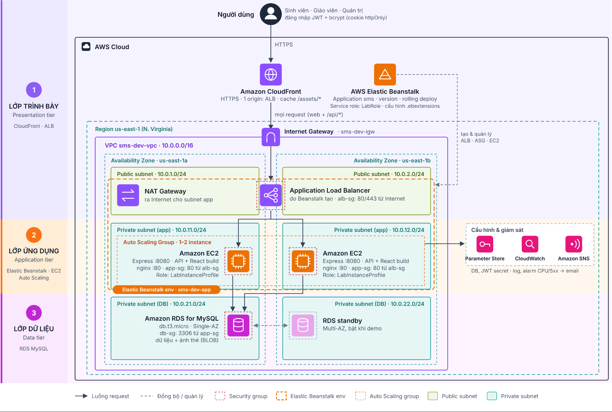
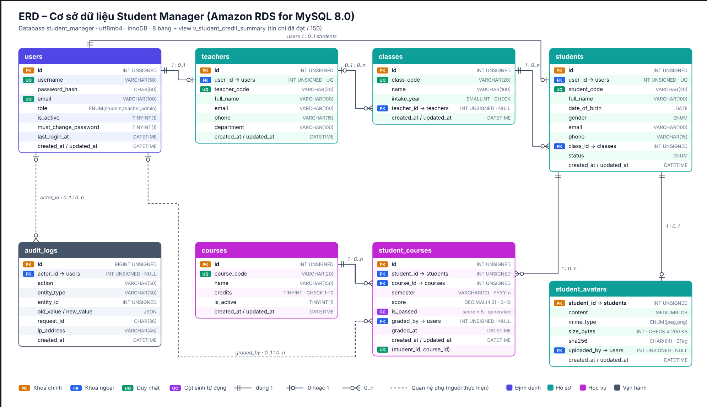
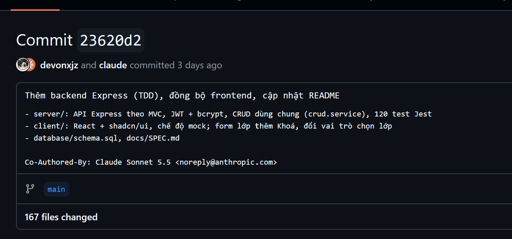

# BÁO CÁO TUẦN 1 – ĐỒ ÁN CLOUD COMPUTING

## Triển khai ứng dụng Quản lý sinh viên Node.js lên AWS Elastic Beanstalk

**TRƯỜNG ĐẠI HỌC CÔNG NGHỆ KỸ THUẬT TP.HCM**  
**KHOA CÔNG NGHỆ THÔNG TIN**

| Thông tin | Nội dung |
| --- | --- |
| Học kỳ | Học kỳ I – Năm học 2026–2027 |
| Mã lớp | CLCO332779_05UTEXMC |
| Giảng viên hướng dẫn | TS. Huỳnh Xuân Phụng |
| Sinh viên 1 | Trần Lê Thái – 24110331 |
| Sinh viên 2 | Nông Hoàng Anh – 24110154 |
| Đề tài | Triển khai ứng dụng Quản lý sinh viên Node.js lên AWS Elastic Beanstalk |
| Môi trường dự kiến | AWS Academy Learner Lab, region `us-east-1` |
| Kho mã nguồn | [student-manager-ops](https://github.com/devonxjz/student-manager-ops) |

> Báo cáo này trình bày trực tiếp công việc, kết quả, phân công và mức sử dụng AI trong tuần 1. Các liên kết GitHub bên dưới là dẫn chứng kèm theo; nội dung báo cáo không phụ thuộc vào file đính kèm.

## 1. Tổng kết công việc tuần 1

Trong tuần 1, nhóm tập trung đọc yêu cầu đề tài, xây dựng đặc tả ứng dụng, thiết kế cơ sở dữ liệu, chuẩn bị mã nguồn backend/frontend và nghiên cứu phương án triển khai trên AWS.

Ứng dụng sử dụng **Node.js, Express, React và MySQL**, hướng tới quản lý hồ sơ sinh viên và phân quyền cho ba nhóm người dùng: **ADMIN, Giảng viên và Student**.

Nhóm **chưa tạo tài nguyên trên AWS trong tuần 1**. Các nội dung VPC, subnet, security group, Elastic Beanstalk, RDS và tag mới ở mức nghiên cứu hoặc thiết kế dự kiến.

### 1.1. Danh sách công việc và dẫn chứng

| STT | Công việc đã làm | Nội dung và kết quả | Dẫn chứng GitHub |
| --- | --- | --- | --- |
| 1 | Đọc và phân tích yêu cầu đề tài | Xác định nền tảng triển khai bắt buộc là Elastic Beanstalk; ghi nhận các ràng buộc về Learner Lab, region, IAM và loại instance | [Đặc tả dự án](https://github.com/devonxjz/student-manager-ops/blob/23620d252666851881d7ceaabb456931086e42a4/docs/SPEC.md), [commit liên quan](https://github.com/devonxjz/student-manager-ops/commit/23620d252666851881d7ceaabb456931086e42a4) |
| 2 | Xây dựng đặc tả ứng dụng | Mô tả bài toán quản lý sinh viên, nhóm người dùng, chức năng và cấu trúc dự án | [docs/SPEC.md](https://github.com/devonxjz/student-manager-ops/blob/23620d252666851881d7ceaabb456931086e42a4/docs/SPEC.md) |
| 3 | Thiết kế cơ sở dữ liệu | Chuẩn bị thiết kế 7 bảng, quan hệ giữa các bảng, ERD và script tạo cơ sở dữ liệu | [docs/Database_Design.md](https://github.com/devonxjz/student-manager-ops/blob/23620d252666851881d7ceaabb456931086e42a4/docs/Database_Design.md), [database/schema.sql](https://github.com/devonxjz/student-manager-ops/blob/23620d252666851881d7ceaabb456931086e42a4/database/schema.sql), [commit liên quan](https://github.com/devonxjz/student-manager-ops/commit/23620d252666851881d7ceaabb456931086e42a4) |
| 4 | Chuẩn bị backend | Xây dựng cấu trúc mã nguồn Express, bản nháp xử lý nghiệp vụ và kết nối MySQL; sinh viên chỉnh sửa và đọc hiểu mã | [File backend tiêu biểu](https://github.com/devonxjz/student-manager-ops/blob/23620d252666851881d7ceaabb456931086e42a4/server/src/services/credit.service.js), [commit backend](https://github.com/devonxjz/student-manager-ops/commit/23620d252666851881d7ceaabb456931086e42a4) |
| 5 | Chuẩn bị frontend | Xây dựng cấu trúc React và bản nháp giao diện phục vụ ứng dụng quản lý sinh viên | [File frontend tiêu biểu](https://github.com/devonxjz/student-manager-ops/blob/23620d252666851881d7ceaabb456931086e42a4/client/src/pages/admin/StudentsPage.jsx), [commit frontend](https://github.com/devonxjz/student-manager-ops/commit/23620d252666851881d7ceaabb456931086e42a4) |
| 6 | Chạy kiểm thử tại máy cá nhân | Chạy Jest và Playwright để kiểm tra ứng dụng; lần chạy lại ngày 17/10 đạt 120/120 test Jest và 32/32 test Playwright | [File kiểm thử tiêu biểu](https://github.com/devonxjz/student-manager-ops/blob/23620d252666851881d7ceaabb456931086e42a4/server/tests/auth.test.js), [kết quả hoặc nhật ký kiểm thử](https://github.com/devonxjz/student-manager-ops/blob/main/docs/tuan-1/evidence/tuan-1-ket-qua-kiem-thu.md) |
| 7 | Nghiên cứu dịch vụ và thiết kế hạ tầng | Phân tích kiến trúc 3 tầng, mạng qua 2 AZ, luồng request, security group và phương án triển khai | [Báo cáo gốc BC_Tuan1_AWS.docx, mục 2–4](https://github.com/devonxjz/student-manager-ops/blob/23620d252666851881d7ceaabb456931086e42a4/docs/BC_Tuan1_AWS.docx), [SPEC.md mục 2](https://github.com/devonxjz/student-manager-ops/blob/23620d252666851881d7ceaabb456931086e42a4/docs/SPEC.md?plain=1#L32-L69), [commit liên quan](https://github.com/devonxjz/student-manager-ops/commit/23620d252666851881d7ceaabb456931086e42a4) |
| 8 | Xây dựng quy ước tag | Xác định các tag `Name`, `Project`, `Environment`, `Owner`, `ManagedBy` và quy ước đặt tên tài nguyên | [Báo cáo gốc BC_Tuan1_AWS.docx, mục 5](https://github.com/devonxjz/student-manager-ops/blob/23620d252666851881d7ceaabb456931086e42a4/docs/BC_Tuan1_AWS.docx) |
| 9 | Viết báo cáo và khai báo AI | Tổng hợp công việc, phân công, thời gian, hạn chế và phần AI hỗ trợ | [Báo cáo tuần 1 trên GitHub](https://github.com/devonxjz/student-manager-ops/blob/main/docs/tuan-1/B%C3%A1o%20c%C3%A1o%20tu%E1%BA%A7n%201.md), [commit cập nhật báo cáo](https://github.com/devonxjz/student-manager-ops/commits/main/docs/tuan-1/B%C3%A1o%20c%C3%A1o%20tu%E1%BA%A7n%201.md) |

## 2. Nội dung công việc đã thực hiện

### 2.1. Phân tích yêu cầu và đặc tả ứng dụng

Nhóm đã xác định:

- Bài toán chính: quản lý hồ sơ sinh viên, hỗ trợ thao tác thêm, xem, sửa và xóa theo quyền.
- Ba nhóm người dùng dự kiến: ADMIN, Giảng viên và Student.
- Backend sử dụng Node.js và Express.
- Frontend sử dụng React.
- Dữ liệu quan hệ được lưu bằng MySQL.
- Nền tảng triển khai theo đề tài là AWS Elastic Beanstalk.
- Môi trường thực hành là AWS Academy Learner Lab tại `us-east-1`.

**Sản phẩm:** tài liệu `docs/SPEC.md`.

**Dẫn chứng:** [Xem đặc tả](https://github.com/devonxjz/student-manager-ops/blob/23620d252666851881d7ceaabb456931086e42a4/docs/SPEC.md) · [Xem commit](https://github.com/devonxjz/student-manager-ops/commit/23620d252666851881d7ceaabb456931086e42a4).

### 2.2. Thiết kế cơ sở dữ liệu

Nhóm đã chuẩn bị thiết kế cơ sở dữ liệu gồm 7 bảng theo tài liệu dự án, xác định quan hệ, khóa chính, khóa ngoại và script tạo bảng.

Các nhóm dữ liệu được xem xét gồm hồ sơ sinh viên, lớp, môn học, đăng ký học và điểm. Danh sách bảng, tên cột và ràng buộc cụ thể được trình bày trong tài liệu thiết kế và `schema.sql`.

Ảnh thẻ sinh viên được đề xuất lưu dưới dạng BLOB trong MySQL ở phạm vi đồ án. Đây là phương án thiết kế; nhóm chưa triển khai RDS trong tuần 1.

Lưu ý: quyết định lưu BLOB được đưa ra sau khi đẩy mã. `schema.sql` và `Database_Design.md` tại commit dẫn chứng vẫn dùng cột `avatar_key` (lưu key ảnh trên S3); hai tệp này sẽ được cập nhật sang BLOB trong tuần 2.

**Sản phẩm:** `docs/Database_Design.md`, `database/schema.sql`.

**Dẫn chứng:** [Thiết kế và ERD](https://github.com/devonxjz/student-manager-ops/blob/23620d252666851881d7ceaabb456931086e42a4/docs/Database_Design.md) · [Script SQL](https://github.com/devonxjz/student-manager-ops/blob/23620d252666851881d7ceaabb456931086e42a4/database/schema.sql) · [Commit](https://github.com/devonxjz/student-manager-ops/commit/23620d252666851881d7ceaabb456931086e42a4).

### 2.3. Chuẩn bị mã nguồn backend và frontend

Nhóm đã lên cấu trúc dự án, chuẩn bị bản nháp backend trong `server/` và frontend trong `client/`.

Công việc của sinh viên gồm:

- Xác định cấu trúc và ý tưởng triển khai.
- Sử dụng AI hỗ trợ sinh một phần bản nháp.
- Chỉnh sửa bản nháp, bổ sung một phần mã nguồn.
- Đọc hiểu luồng xử lý và chạy ứng dụng tại máy cá nhân.
- Chuẩn bị ứng dụng cho bước tích hợp và triển khai ở các tuần sau.

Trạng thái tuần 1 là **mã nguồn phát triển tại máy cá nhân**, chưa phải ứng dụng đã triển khai trên AWS. Mức hoàn thiện của từng chức năng cần đối chiếu với mã nguồn tại commit dẫn chứng.

**Dẫn chứng backend:** [File tiêu biểu](https://github.com/devonxjz/student-manager-ops/blob/23620d252666851881d7ceaabb456931086e42a4/server/src/services/credit.service.js) · [Commit](https://github.com/devonxjz/student-manager-ops/commit/23620d252666851881d7ceaabb456931086e42a4).

**Dẫn chứng frontend:** [File tiêu biểu](https://github.com/devonxjz/student-manager-ops/blob/23620d252666851881d7ceaabb456931086e42a4/client/src/pages/admin/StudentsPage.jsx) · [Commit](https://github.com/devonxjz/student-manager-ops/commit/23620d252666851881d7ceaabb456931086e42a4).

### 2.4. Kiểm thử tại máy cá nhân

Nhóm đã thực hiện chạy kiểm thử bằng Jest và Playwright, đồng thời đọc mã nguồn để kiểm tra luồng hoạt động.

Kết quả dưới đây là lần chạy lại ngày 17/10/2026 trên đúng mã nguồn của commit dẫn chứng (mã trong `server/`, `client/`, `database/` không thay đổi so với commit này).

| Nội dung cần ghi nhận | Kết quả thực tế |
| --- | --- |
| Ngày chạy kiểm thử | 17/10/2026 (chạy lại sau tuần 1), Windows 11, Node.js v24.16.0 |
| Commit được kiểm thử | [`23620d2`](https://github.com/devonxjz/student-manager-ops/commit/23620d252666851881d7ceaabb456931086e42a4) |
| Kết quả Jest | 120/120 test đạt, 0 không đạt (6 test suite, SQLite trong bộ nhớ) |
| Kết quả Playwright | 32/32 test đạt, 0 không đạt (Chrome, chạy trên API giả) |
| Lỗi còn tồn tại | Không có test lỗi. Giới hạn: backend chưa test trên MySQL/RDS thật, Playwright chưa nối backend thật |

**Dẫn chứng:** [Jest: auth.test.js](https://github.com/devonxjz/student-manager-ops/blob/23620d252666851881d7ceaabb456931086e42a4/server/tests/auth.test.js) · [Playwright: admin.spec.js](https://github.com/devonxjz/student-manager-ops/blob/23620d252666851881d7ceaabb456931086e42a4/client/e2e/admin.spec.js) · [Nhật ký hoặc kết quả kiểm thử](https://github.com/devonxjz/student-manager-ops/blob/main/docs/tuan-1/evidence/tuan-1-ket-qua-kiem-thu.md).

## 3. Nghiên cứu dịch vụ AWS

Trong tuần 1, nhóm tìm hiểu vai trò của các dịch vụ phục vụ phương án triển khai:

| Dịch vụ | Vai trò dự kiến trong dự án |
| --- | --- |
| Amazon VPC | Tổ chức mạng, subnet, route table và security group |
| AWS Elastic Beanstalk | Quản lý môi trường chạy ứng dụng Node.js theo yêu cầu đề tài |
| Amazon EC2 | Cung cấp instance chạy ứng dụng trong môi trường Elastic Beanstalk |
| Application Load Balancer | Phân phối request và kiểm tra tình trạng instance |
| EC2 Auto Scaling | Điều chỉnh số instance trong môi trường load-balanced |
| Amazon RDS for MySQL | Lưu dữ liệu quan hệ của ứng dụng |
| Amazon S3 | Phục vụ nhu cầu lưu trữ liên quan đến triển khai; vai trò cụ thể sẽ được chốt khi cấu hình |
| Amazon CloudFront | Phương án phân phối nội dung và cung cấp điểm truy cập HTTPS |
| AWS Systems Manager Parameter Store | Phương án quản lý cấu hình kết nối ứng dụng |
| Amazon CloudWatch | Thu thập log, metric và thiết lập cảnh báo |
| Amazon SNS | Phương án gửi thông báo cảnh báo |
| AWS IAM | Sử dụng quyền được cấp trong Learner Lab qua `LabRole` và `LabInstanceProfile` |

Các dịch vụ trên đang ở mức nghiên cứu; việc có được phép sử dụng và cấu hình cụ thể cần kiểm tra trên Learner Lab thực tế.

**Hạn chế:** bản thiết kế ban đầu mô tả EC2 và Auto Scaling khá độc lập, chưa làm rõ vai trò quản lý của Elastic Beanstalk. Nhóm cần sửa tài liệu, sơ đồ và bổ sung nội dung `.ebextensions`, rolling deployment, rollback để thống nhất với đề tài.

**Dẫn chứng:** [Báo cáo gốc BC_Tuan1_AWS.docx, mục 2–4](https://github.com/devonxjz/student-manager-ops/blob/23620d252666851881d7ceaabb456931086e42a4/docs/BC_Tuan1_AWS.docx).

## 4. Thiết kế kiến trúc dự kiến

### 4.1. Phân chia ba tầng

| Tầng | Thành phần dự kiến | Vai trò |
| --- | --- | --- |
| Trình bày | Giao diện React, được Express phục vụ; cân nhắc CloudFront phía trước | Hiển thị giao diện và gửi yêu cầu API |
| Ứng dụng | Express chạy trên EC2 do Elastic Beanstalk quản lý, phía sau ALB | Xử lý nghiệp vụ và phân quyền |
| Dữ liệu | RDS for MySQL trong subnet dữ liệu private | Lưu trữ dữ liệu ứng dụng |

### 4.2. Luồng request dự kiến

1. Trình duyệt truy cập giao diện ứng dụng.
2. Nếu sử dụng CloudFront, request được chuyển từ CloudFront tới ALB.
3. ALB chuyển request tới ứng dụng Express trong môi trường Elastic Beanstalk.
4. Backend xác thực người dùng và kiểm tra quyền.
5. Backend truy vấn MySQL và trả kết quả cho trình duyệt.
6. Log và metric được thu thập để phục vụ giám sát.

### 4.3. Thiết kế mạng và bảo mật

- Dự kiến sử dụng 6 subnet thuộc 2 Availability Zone: 2 subnet public, 2 subnet ứng dụng và 2 subnet dữ liệu.
- ALB nằm trong subnet public.
- Instance ứng dụng dự kiến nằm trong subnet private và không mở SSH công khai.
- RDS nằm trong subnet dữ liệu private.
- Security group ứng dụng chỉ nhận lưu lượng từ security group ALB trên cổng phục vụ ứng dụng.
- Security group RDS chỉ nhận kết nối MySQL từ security group ứng dụng.
- Cổng ứng dụng sẽ được thống nhất giữa cấu hình Node.js, proxy, health check và Elastic Beanstalk.
- Dự kiến dùng một NAT Gateway để giảm chi phí lab; phương án này có hạn chế về khả năng chịu lỗi.
- RDS dự kiến chạy Single-AZ ở môi trường dev. Việc có subnet tại 2 AZ không đồng nghĩa database đang chạy Multi-AZ.

**Trạng thái:** chưa tạo hoặc kiểm thử kiến trúc trên AWS.

**Dẫn chứng:** [Báo cáo gốc BC_Tuan1_AWS.docx, mục 3–4 (có sơ đồ)](https://github.com/devonxjz/student-manager-ops/blob/23620d252666851881d7ceaabb456931086e42a4/docs/BC_Tuan1_AWS.docx).

## 5. Quy ước đặt tên và gắn tag

Nhóm đã thống nhất quy ước tên:

`sms-<moi-truong>-<thanh-phan>[-<az>]`

Ví dụ: `sms-dev-app-a`.

| Tag | Giá trị dự kiến | Mục đích |
| --- | --- | --- |
| Name | `sms-dev-app-a` | Nhận diện tài nguyên |
| Project | `StudentMgmt` | Nhóm tài nguyên theo dự án |
| Environment | `dev` | Xác định môi trường |
| Owner | `24110331-24110154` | Xác định nhóm phụ trách |
| ManagedBy | `console`, `cli` hoặc `cloudformation` | Ghi nhận cách quản lý |
| Tier | `public`, `app`, `db` | Phân loại tầng mạng |

Nhóm dự kiến gắn tag khi tạo tài nguyên, kiểm tra khả năng truyền tag cho tài nguyên do Elastic Beanstalk tạo và rà soát bằng Tag Editor.

**Trạng thái tuần 1:** đã có quy ước, chưa gắn tag trên tài nguyên AWS thực tế.

**Dẫn chứng:** [Báo cáo gốc BC_Tuan1_AWS.docx, mục 5](https://github.com/devonxjz/student-manager-ops/blob/23620d252666851881d7ceaabb456931086e42a4/docs/BC_Tuan1_AWS.docx).

## 6. Phân công và thời gian thực hiện

Thời gian dưới đây là số giờ mỗi sinh viên tham gia theo nhật ký nhóm.

| Công việc | Trần Lê Thái           | Nông Hoàng Anh         | Sản phẩm                        |
| --- |------------------------|------------------------|---------------------------------|
| Đọc yêu cầu và hướng dẫn Learner Lab | 1 giờ                  | 1 giờ                  | Ghi chú yêu cầu                 |
| Tìm hiểu dịch vụ AWS | 2,5 giờ                | 2,5 giờ                | Nội dung nghiên cứu dịch vụ     |
| Thiết kế kiến trúc và luồng request | 1,5 giờ                | 1,5 giờ                | Tài liệu kiến trúc              |
| Vẽ sơ đồ kiến trúc | 1 giờ                  | —                      | Sơ đồ kiến trúc                 |
| Xây dựng quy ước tag | 0,5 giờ                | 0,5 giờ                | Quy ước tên và tag              |
| Viết đặc tả chức năng | 1 giờ                  | 1 giờ                  | `docs/SPEC.md`                  |
| Thiết kế cơ sở dữ liệu và script SQL | —                      | 1 giờ                  | Tài liệu thiết kế, `schema.sql` |
| Chuẩn bị backend và frontend | 2 giờ, phụ trách chính | 1 giờ, hỗ trợ          | `server/`, `client/`            |
| Chạy kiểm thử, đọc hiểu mã nguồn | 1 giờ                  | 1 giờ                  | Kết quả kiểm thử                |
| Viết và rà soát báo cáo | rà soát                | 1 giờ, phụ trách chính | Báo cáo tuần 1                  |
| **Tổng** | **9,5 giờ**            | **9,5 giờ**            | **19 giờ công**                 |

## 7. Commit và khả năng đối chiếu công việc

Các commit cần được dẫn trực tiếp để giảng viên kiểm tra nội dung thay đổi và đối chiếu với báo cáo.

| Nhóm công việc | Người phụ trách theo phân công | Commit dẫn chứng |
| --- | --- | --- |
| Đặc tả chức năng | Cả hai | [Xem commit](https://github.com/devonxjz/student-manager-ops/commit/23620d252666851881d7ceaabb456931086e42a4) |
| Thiết kế cơ sở dữ liệu | Nông Hoàng Anh | [Xem commit](https://github.com/devonxjz/student-manager-ops/commit/23620d252666851881d7ceaabb456931086e42a4) |
| Backend | Trần Lê Thái phụ trách chính, Nông Hoàng Anh hỗ trợ | [Xem commit](https://github.com/devonxjz/student-manager-ops/commit/23620d252666851881d7ceaabb456931086e42a4) |
| Frontend | Trần Lê Thái phụ trách chính, Nông Hoàng Anh hỗ trợ | [Xem commit](https://github.com/devonxjz/student-manager-ops/commit/23620d252666851881d7ceaabb456931086e42a4) |
| Kiến trúc và quy ước tag | Cả hai | [Xem commit](https://github.com/devonxjz/student-manager-ops/commit/23620d252666851881d7ceaabb456931086e42a4) |
| Báo cáo và khai báo AI | Nông Hoàng Anh viết chính, Trần Lê Thái rà soát | [Xem commit](https://github.com/devonxjz/student-manager-ops/commits/main/docs/tuan-1/B%C3%A1o%20c%C3%A1o%20tu%E1%BA%A7n%201.md) |

Thông tin người phụ trách trong bảng thể hiện phân công của nhóm. Tác giả, thời điểm và nội dung commit được đối chiếu trực tiếp trên GitHub.

Trong tuần 1, toàn bộ mã nguồn và tài liệu được gộp lại và đẩy lên trong một commit từ máy của Trần Lê Thái ngày 14/10/2026, nên mọi commit tuần 1 đều đứng tên tài khoản `devonxjz`. Phần việc của Nông Hoàng Anh (thiết kế cơ sở dữ liệu, báo cáo) được đối chiếu qua nội dung tệp trong commit đó. Từ tuần 2, mỗi thành viên commit bằng tài khoản GitHub của mình.

## 8. Khai báo sử dụng AI

**Nhóm có sử dụng AI trong tuần 1**, gồm Gemini và Claude. AI được dùng để tham khảo kiến thức, góp ý và sinh một phần bản nháp. 

| Hạng mục | Công cụ | Phần AI hỗ trợ                                                           | Phần sinh viên thực hiện                                                                                                       |
| --- | --- |--------------------------------------------------------------------------|--------------------------------------------------------------------------------------------------------------------------------|
| Nghiên cứu AWS | Gemini | Giải thích khái niệm và so sánh phương án                                | Đọc tài liệu, chọn phương án và kiểm tra sự phù hợp                                                                            |
| Kiến trúc và tag | Claude | Góp ý thiết kế                                                           | Quyết định phương án, vẽ sơ đồ và đặt quy ước                                                                                  |
| Đặc tả và cơ sở dữ liệu | Claude | Rà soát, góp ý ràng buộc                                                 | Viết đặc tả, thiết kế bảng và quan hệ                                                                                          |
| Backend, frontend | Claude | Sinh một phần bản nháp mã nguồn                                          | Lên cấu trúc, sửa bản nháp, tự viết một phần, đọc hiểu và chạy thử                                                             |
| Báo cáo ban đầu | Gemini | Hỗ trợ trình bày                                                         | Kiểm tra nội dung theo tiến độ thực tế                                                                                         |
| Bản chỉnh sửa để nộp lại | Claude | Hỗ trợ tổ chức lại báo cáo, làm rõ dẫn chứng, đối chiếu báo cáo với repo | Kiểm tra từng link và số liệu, quyết định nội dung, điền link dẫn chứng, chạy kiểm thử và ghi kết quả.|
| Thao tác AWS | Không sử dụng trong tuần 1 | Không có                                                                 | Tuần 1 chưa tạo tài nguyên AWS                                                                                                 |

### Quy ước mức hỗ trợ

- **Không:** sinh viên tự thực hiện, không sử dụng AI.
- **Tham khảo:** AI giải thích hoặc góp ý; sinh viên tự viết và quyết định.
- **Bản nháp:** AI tạo bản đầu; sinh viên sửa, kiểm chứng và phải giải thích được phần sử dụng.

## 9. Công việc chưa hoàn thành

| Hạng mục | Trạng thái cuối tuần 1 |
| --- | --- |
| Chuẩn bị đặc tả và thiết kế cơ sở dữ liệu | Đã có sản phẩm, dẫn chứng ở mục 1 và 2 |
| Chuẩn bị mã nguồn ứng dụng | Đã có bản phát triển tại máy cá nhân |
| Kiểm thử ứng dụng | Đã ghi kết quả ở mục 2.4 |
| Thiết kế triển khai bằng Elastic Beanstalk | Cần hoàn thiện và thống nhất tài liệu |
| Cập nhật `schema.sql` và `Database_Design.md` sang lưu ảnh thẻ dạng BLOB | Chưa thực hiện |
| Tạo VPC, subnet, route table, security group | Chưa thực hiện |
| Kiểm tra quyền thực tế của LabRole và LabInstanceProfile | Chưa thực hiện trên môi trường triển khai |
| Tạo S3 và RDS | Chưa thực hiện |
| Tạo môi trường Elastic Beanstalk | Chưa thực hiện |
| Gắn tag và kiểm tra bằng Tag Editor | Chưa thực hiện |
| Viết template hạ tầng IaC | Chưa có |
| Ảnh minh chứng AWS có Account ID, region và thời gian | Chưa có |

## 10. Kế hoạch tuần 2

1. Hoàn thiện thiết kế và sơ đồ theo AWS Elastic Beanstalk; cập nhật `schema.sql` và `Database_Design.md` sang lưu ảnh thẻ dạng BLOB.
2. Kiểm tra quyền và giới hạn thực tế trong Learner Lab.
3. Dựng VPC, subnet, route table và security group.
4. Tạo các tài nguyên lưu trữ, cơ sở dữ liệu cần thiết.
5. Triển khai ứng dụng lên môi trường Elastic Beanstalk theo yêu cầu đề tài.
6. Gắn tag và kiểm tra tài nguyên đã tạo.
7. Bổ sung cấu hình hạ tầng, hướng dẫn triển khai và commit lên GitHub.
8. Chụp minh chứng có Account ID, region, thời gian; ghi lại kiểm thử và chi phí.
9. Dừng hoặc xóa tài nguyên sau buổi thực hành theo hướng dẫn của môn học.

## 11. Liên kết tổng hợp

- **Kho mã nguồn:** [student-manager-ops](https://github.com/devonxjz/student-manager-ops).
- **Đặc tả:** [docs/SPEC.md](https://github.com/devonxjz/student-manager-ops/blob/23620d252666851881d7ceaabb456931086e42a4/docs/SPEC.md).
- **Thiết kế cơ sở dữ liệu:** [docs/Database_Design.md](https://github.com/devonxjz/student-manager-ops/blob/23620d252666851881d7ceaabb456931086e42a4/docs/Database_Design.md).
- **Script SQL:** [database/schema.sql](https://github.com/devonxjz/student-manager-ops/blob/23620d252666851881d7ceaabb456931086e42a4/database/schema.sql).
- **Commit cập nhật báo cáo nộp lại:** [Xem thay đổi](https://github.com/devonxjz/student-manager-ops/commits/main/docs/tuan-1/B%C3%A1o%20c%C3%A1o%20tu%E1%BA%A7n%201.md).