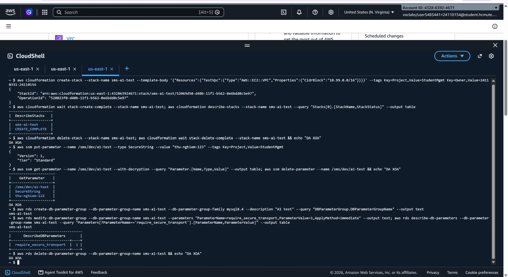
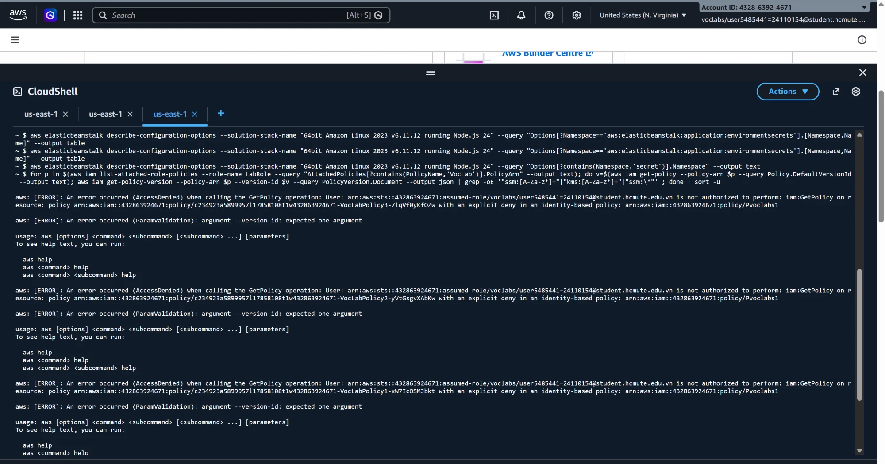
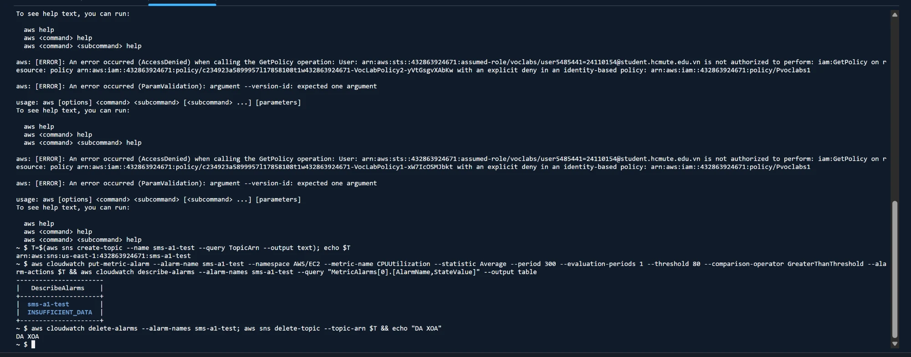

# A1 – Kiểm tra quyền cho IaC, bí mật và giám sát

Thực hiện trên CloudShell, account `4328-6392-4671`, region `us-east-1`. Mỗi bài tạo một tài nguyên thử rồi xóa ngay.

| Bài | Kiểm tra | Kết quả | Ảnh hưởng tới kế hoạch |
| --- | --- | --- | --- |
| 1 | CloudFormation tạo/xóa stack có tag (VPC thử `10.99.0.0/16`) | ✔ `CREATE_COMPLETE`, xóa được | Dùng được IaC cho cả 4 stack |
| 2 | Parameter Store `SecureString` (`/sms/dev/a1-test`) | ✔ Ghi, đọc có giải mã, xóa được | Lưu được `db-password`, `jwt-secret` |
| 3 | DB parameter group `mysql8.4` tùy chỉnh, `require_secure_transport=1` | ✔ Tạo, sửa, xóa được | Bật bắt buộc SSL cho RDS được |
| 4 | Beanstalk namespace `aws:elasticbeanstalk:application:environmentsecrets` (Node.js 24, AL2023 6.11.12) | ✘ Không có; không có namespace nào chứa `secret` | Beanstalk **không** tự đọc bí mật từ Parameter Store. Ứng dụng tự đọc (xem dưới) |
| 5 | Đọc nội dung VocLabPolicy của LabRole | ✘ `iam:GetPolicy` bị chặn (explicit deny, policy `Pvoclabs1`) | Chưa biết LabRole có `ssm:GetParameter`, `kms:Decrypt`; kiểm chứng khi chạy thật ở T5 |
| 6 | SNS topic + CloudWatch alarm CPU | ✔ Tạo được, alarm `INSUFFICIENT_DATA`, xóa được | Làm được A5 |

## Quyết định sau A1

**Cách đưa bí mật vào ứng dụng:** vì bài 4 không đạt, ứng dụng tự đọc Parameter Store khi khởi động:

- Biến môi trường chỉ chứa **tên** tham số: `DB_PASSWORD_PARAM=/sms/dev/db-password`, `JWT_SECRET_PARAM=/sms/dev/jwt-secret`. Không còn giá trị bí mật nằm trong cấu hình Beanstalk.
- Khi khởi động, ứng dụng dùng AWS SDK (`@aws-sdk/client-ssm`) với quyền của instance profile (`LabInstanceProfile` → `LabRole`) để lấy giá trị, rồi mới nạp cấu hình và kết nối DB.
- Nếu không đọc được (LabRole thiếu quyền), ứng dụng ghi log rõ nguyên nhân và dùng `DB_PASSWORD`/`JWT_SECRET` nếu có. Đây là phương án dự phòng, sẽ ghi vào báo cáo nếu phải dùng.

**Mật khẩu RDS trong `database.yaml`:** dùng dynamic reference `{{resolve:ssm-secure:/sms/dev/db-password}}`. CloudFormation hỗ trợ cách này cho thuộc tính `MasterUserPassword` của RDS.

## Minh chứng

