# BÁO CÁO TUẦN 3 – ĐỒ ÁN CLOUD COMPUTING

## Tích hợp, bảo mật, giám sát và IaC

**TRƯỜNG ĐẠI HỌC CÔNG NGHỆ KỸ THUẬT TP.HCM**  
**KHOA CÔNG NGHỆ THÔNG TIN**

| Thông tin | Nội dung |
| --- | --- |
| Học kỳ | Học kỳ I – Năm học 2026–2027 |
| Mã lớp | CLCO332779_05UTEXMC |
| Giảng viên hướng dẫn | TS. Huỳnh Xuân Phụng |
| Sinh viên 1 | Trần Lê Thái – 24110331 |
| Sinh viên 2 | Nông Hoàng Anh – 24110154 |
| Thời gian | Tuần 3 |
| Môi trường | AWS Academy Learner Lab, region `us-east-1`; hệ thống trình bày trong báo cáo chạy ở account `4328-6392-4671` (Nông Hoàng Anh) |
| Kho mã nguồn | [student-manager-ops](https://github.com/devonxjz/student-manager-ops) |
| Kế hoạch tuần 3 | [Kế hoạch tuần 3.md](K%E1%BA%BF%20ho%E1%BA%A1ch%20tu%E1%BA%A7n%203.md) |
| Nhật ký công việc | [worklog-tuan-3.md](worklog-tuan-3.md) |
| Template hạ tầng | [`infra/`](../../infra/) |

## 1. Tổng kết công việc tuần 3

Hạ tầng dựng tay của tuần 2 được viết lại thành **CloudFormation** (4 stack) và dựng thành công. Hệ thống hoàn chỉnh (4 stack) chạy ở account `4328-6392-4671` của Nông Hoàng Anh, là hệ thống được trình bày trong báo cáo. Trần Lê Thái dựng cùng bộ template ở account `2751-7291-1137`. Đã triển khai thành công cùng bộ template trên hai account Learner Lab có các điều kiện tiên quyết tương ứng.

Thông tin nhạy cảm được chuyển sang **Parameter Store** và ứng dụng tự đọc khi khởi động; RDS bắt buộc SSL (`require_secure_transport = 1`); giám sát gồm SNS, 5 alarm và dashboard; rolling deploy và rollback chạy bằng tham số `VersionLabel` của stack.

### 1.1. Danh sách công việc và dẫn chứng

| STT | Mã | Công việc | Người | Trạng thái | Dẫn chứng |
| --- | --- | --- | --- | --- | --- |
| 1 | A1 | Kiểm tra quyền Learner Lab cho IaC, bí mật, giám sát | Hoàng Anh | ✔ | [A1-kiem-tra-quyen.md](A1-kiem-tra-quyen.md) |
| 2 | A2 | `infra/network.yaml`, stack `sms-dev-network` | Hoàng Anh | ✔ | Mục 2.3 |
| 3 | A3 | Parameter Store, `infra/database.yaml`, stack `sms-dev-database` | Hoàng Anh | ✔ | Mục 2.4 |
| 4 | A4 | Nạp dữ liệu; xóa hạ tầng dựng tay tuần 2 | Hoàng Anh | ✔ | Mục 2.5 |
| 5 | T1 | SSL tới RDS, đọc bí mật từ Parameter Store | Thái | ✔ | Mục 2.6 |
| 6 | T2 | `npm audit` | Thái | ✔ | Mục 2.6 |
| 7 | T3 | `.ebextensions`: đóng SSH, sửa tag | Thái | ✔ | Mục 2.6 |
| 8 | T4, T5 | `infra/app.yaml`, dựng và kiểm tra toàn hệ thống | Thái | ✔ | Mục 2.7 |
| 9 | A5 | `infra/monitoring.yaml`, stack `sms-dev-monitoring` | Hoàng Anh | ✔ | Mục 2.8 |
| 10 | T6a, T6b | Rolling deploy `v3 → v4`, rollback về `v3` | Thái, Hoàng Anh | ✔ | Mục 2.9 |
| 11 | T6b | Bắn tải, Auto Scaling, email cảnh báo | Hoàng Anh | ✔ | Mục 2.10 |
| 12 | A6, T7 | Báo cáo, rà soát | Cả hai | ✔ | Báo cáo này |

### 1.2. Mốc

| Mốc | Tiêu chí | Trạng thái |
| --- | --- | --- |
| M1 | `sms-dev-network` CREATE_COMPLETE, 8 export đúng tên | ✔ |
| M2 | `sms-dev-database` CREATE_COMPLETE, kết nối được bằng TLS | ✔ |
| M3 | `sms-dev-app` Health Ok | ✔ `Green`, phiên bản `v3` |
| M4 | Stack giám sát chạy, SNS đã gửi email xác nhận | ✔ |

## 2. Nội dung công việc đã thực hiện

### 2.1. Kiểm tra quyền Learner Lab (A1)

| Bài | Kiểm tra | Kết quả |
| --- | --- | --- |
| 1 | CloudFormation tạo/xóa stack có tag | ✔ |
| 2 | Parameter Store `SecureString` | ✔ |
| 3 | DB parameter group `mysql8.4` tùy chỉnh, `require_secure_transport=1` | ✔ |
| 4 | Beanstalk namespace `environmentsecrets` | ✘ Không có |
| 5 | Đọc policy của LabRole | ✘ `iam:GetPolicy` bị chặn (policy `Pvoclabs1`) |
| 6 | SNS topic + CloudWatch alarm | ✔ |

Vì bài 4 không đạt, **ứng dụng tự đọc bí mật từ Parameter Store** khi khởi động. Bài 5 được kiểm chứng khi chạy thật: log ứng dụng xác nhận LabRole đọc được Parameter Store (mục 2.7). Chi tiết: [A1-kiem-tra-quyen.md](A1-kiem-tra-quyen.md).


### 2.2. Kiến trúc IaC: 4 stack và hợp đồng

```
network.yaml  →  database.yaml  →  app.yaml  →  monitoring.yaml
(Hoàng Anh)      (Hoàng Anh)       (Thái)       (Hoàng Anh)
     M1               M2              M3             M4
```

| Stack | Nội dung | Đầu ra / tham số chính |
| --- | --- | --- |
| `sms-dev-network` | VPC, 6 subnet 2 AZ, IGW, NAT (tham số `EnableNat`), route, S3 endpoint, 4 SG, DB subnet group | Export `sms-dev-VpcId`, `PublicSubnets`, `AppSubnets`, `DbSubnetGroup`, `AlbSg`, `AppSg`, `DbSg`, `AdminSg` |
| `sms-dev-database` | RDS MySQL 8.4 `db.t3.micro`, parameter group riêng | Export `sms-dev-DbEndpoint`, `DbPort`, `DbInstanceId` |
| `sms-dev-app` | Môi trường Beanstalk `sms-dev-app` | Tham số `VersionLabel`; output `ApplicationUrl` |
| `sms-dev-monitoring` | SNS, 5 alarm, dashboard `sms-dev` | Tham số `AlertEmail`, `AsgName`, `AlbFullName` |

Lý do tách 4 stack:

- **Tần suất thay đổi khác nhau:** mạng gần như cố định; ứng dụng đổi thường xuyên.
- **Bảo vệ dữ liệu:** xóa và dựng lại stack ứng dụng không ảnh hưởng RDS.
- **Mỗi người một stack:** hai thành viên làm song song nhờ hợp đồng (tên export, tham số, biến môi trường) chốt trước trong [`infra/README.md`](../../infra/README.md). Stack sau đọc giá trị qua `!ImportValue`, không chép tay ID.
- **Triển khai thành công cùng bộ template trên account Learner Lab có các điều kiện tiên quyết tương ứng:** không ghi cứng AZ hay ID, giải quyết vấn đề tuần 2 là tài nguyên trong account của ai thì chỉ người đó thao tác được.

**Phạm vi IaC.** Bốn stack quản lý các tài nguyên ở bảng trên. Những phần dưới đây nằm ngoài stack, phải có sẵn hoặc làm riêng khi dựng lại từ đầu:

| Phần ngoài stack | Cách thực hiện | Bước trong `infra/README.md` | Lý do |
| --- | --- | --- | --- |
| `LabRole`, `LabInstanceProfile`, key `vockey` | Learner Lab cấp sẵn | — | Learner Lab không cho tạo IAM role |
| Tham số `/sms/dev/db-password`, `/sms/dev/jwt-secret` | CLI `ssm put-parameter` | 2 | CloudFormation không tạo được `SecureString`; giá trị bí mật không nằm trong template |
| Nạp `schema.sql`, seed admin | CLI từ CloudShell VPC environment (tạo trên console) | 4 | Là dữ liệu, không phải hạ tầng |
| Beanstalk Application `student-manager` | CLI `create-application` | 5 | Dùng chung qua các lần xóa và dựng lại môi trường |
| Đóng gói, tải zip lên S3, tạo Application Version | `scripts/package.sh`, CLI `s3 cp`, `create-application-version` | 5 | Stack chỉ chọn phiên bản qua `VersionLabel`; giữ lịch sử phiên bản để rollback |
| Tên ASG, ALB cho `sms-dev-monitoring` | Tra bằng CLI, truyền qua tham số | 8 | Beanstalk tự đặt tên, chỉ biết sau khi môi trường chạy |
| Xác nhận đăng ký SNS | Bấm link trong email | 8 | AWS yêu cầu người nhận xác nhận |
| Group metrics của ASG | CLI trong `scripts/load-test.sh` | 10 | ASG do Beanstalk tạo; phải bật lại nếu ASG được tạo mới |

Quy trình dựng lại từ đầu gồm các bước 0–10 trong [`infra/README.md`](../../infra/README.md).

### 2.3. Stack mạng (A2)

| Hạng mục | Tuần 2 (console) | Tuần 3 (`network.yaml`) |
| --- | --- | --- |
| Route table private | 4 bảng, gỡ NAT khỏi bảng DB bằng tay | 1 bảng app (có NAT), 1 bảng DB (không có `0.0.0.0/0`) |
| NAT | Xóa tay cuối buổi; lần sau tạo lại, sửa route *Blackhole* | `EnableNat=false/true`: tự xóa/tạo NAT, Elastic IP, route |
| Thứ tự tạo SG | Phải nhớ alb → app → admin → db | CloudFormation tự sắp theo `!Ref` |
| Tag | Gắn tay, quên tag `Name` 3 SG | Tag chung qua `--tags`; `Name` có trong template |
| Truyền ID sang RDS, Beanstalk | Chép tay, từng chọn nhầm subnet DB cho EC2 | Export theo tên |

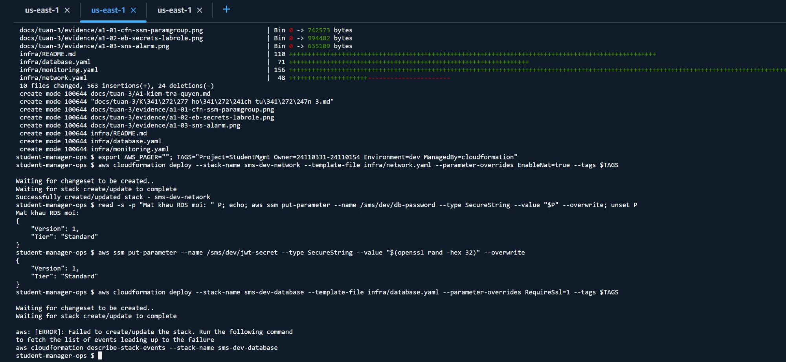

### 2.4. Thông tin bảo mật và stack database (A3)

- Hai tham số `SecureString`: `/sms/dev/db-password`, `/sms/dev/jwt-secret`. Tạo bằng CLI vì CloudFormation không tạo được `SecureString`.
- `database.yaml` lấy mật khẩu bằng `{{resolve:ssm-secure:/sms/dev/db-password}}`: mật khẩu không nằm trong template hay trên Git.
- Parameter group riêng với tham số `RequireSsl`: dựng ở `0`, chuyển lên `1` sau khi ứng dụng kết nối được bằng SSL.
- RDS tên `sms-dev-mysql` để không trùng với `sms-dev-db` dựng tay tuần 2.

| Thuộc tính | Kết quả kiểm tra |
| --- | --- |
| Trạng thái, phiên bản | `available`, MySQL `8.4.11` |
| Instance, AZ | `db.t3.micro`, `us-east-1a` |
| Lưu trữ | `gp3`, mã hóa `True` |
| Public access | `False` |
| VPC, SG | Khớp export `sms-dev-VpcId`, `sms-dev-DbSg` |
| Parameter group | Nhóm do stack tạo, không phải `default.mysql8.4` |

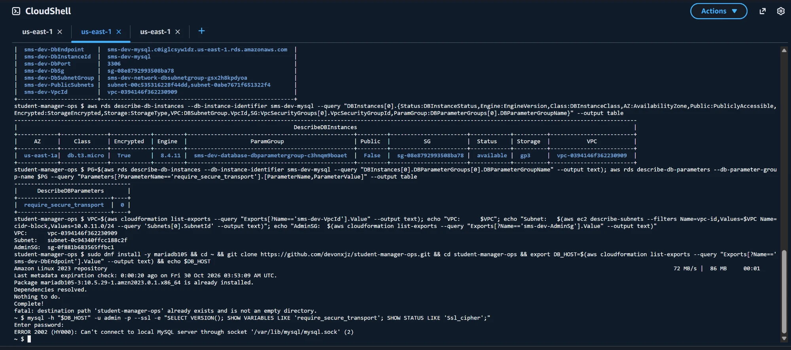

### 2.5. Nạp dữ liệu và xóa hạ tầng tuần 2 (A4)

Kết nối từ CloudShell VPC environment `sms-dev-admin` (VPC mới, subnet `sms-dev-app-a`, SG `sms-dev-AdminSg`):

| Kết quả | Chứng minh |
| --- | --- |
| `git clone`, `dnf install` chạy được | NAT hoạt động |
| Đăng nhập được, `VERSION() = 8.4.11` | `db-sg` nhận `AdminSg`; mật khẩu từ Parameter Store đã nạp vào RDS |
| `Ssl_cipher = TLS_AES_256_GCM_SHA384` | Kết nối quản trị được mã hóa |

Nạp `schema.sql` và seed tài khoản admin. Xóa theo thứ tự phụ thuộc: RDS `sms-dev-db`, DB subnet group `sms-dev-dbsubnet`, rồi VPC `vpc-053736ad602a49096`.

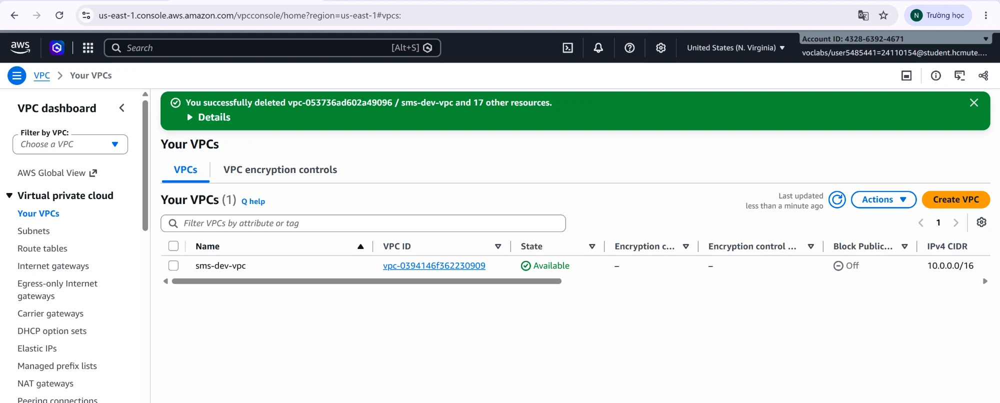

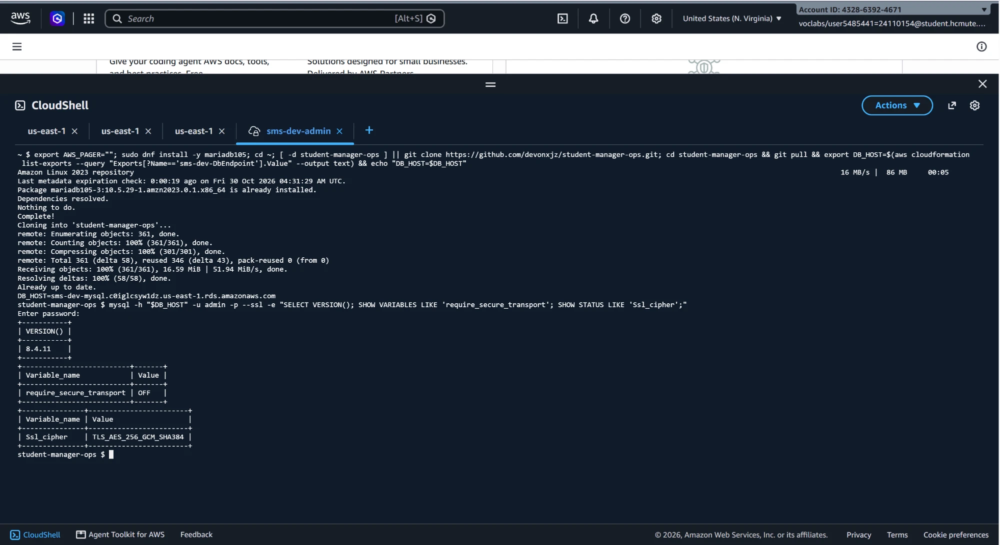
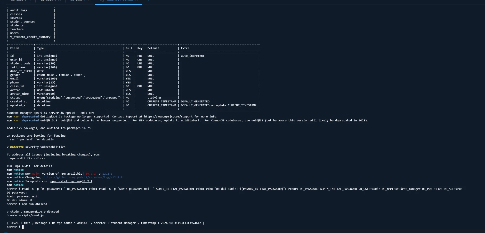
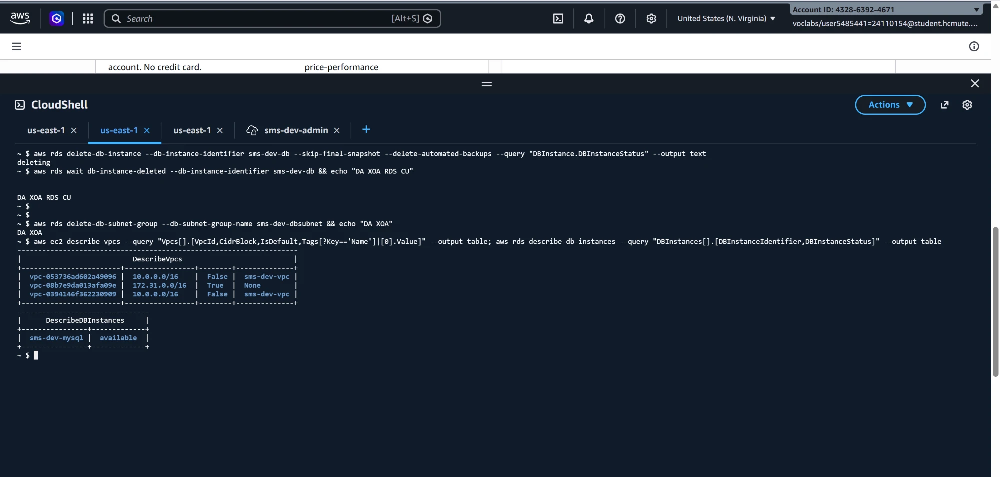

### 2.6. Bảo mật ứng dụng (T1–T3)

- **SSL tới RDS:** khi `DB_SSL=true`, `server/src/config/database.js` đặt `dialectOptions.ssl = 'Amazon RDS'` (dùng chứng chỉ RDS có sẵn trong `mysql2`).
- **Đọc bí mật:** `server/src/config/secrets.js` lấy `DB_PASSWORD`, `JWT_SECRET` từ Parameter Store bằng `@aws-sdk/client-ssm` trước khi nạp cấu hình; không đọc được thì log lỗi và dùng biến môi trường có sẵn.
- **`npm audit`:** nâng `body-parser` lên 1.20.9, xử lý các lỗ hổng mức High.
- **`.ebextensions`:** đóng SSH (`SSHSourceRestriction`), sửa tag `Project=StudentMgmt`.
- Kiểm thử: `npm test` đạt 126/126.

### 2.7. Stack ứng dụng (T4, T5)

`app.yaml` đọc export của 2 stack trước, EC2 ở subnet app, ALB ở subnet public với SG `sms-dev-AlbSg`, biến môi trường chỉ chứa **tên** tham số bí mật.

Kết quả:

- `sms-dev-app` tạo thành công ngay lần đầu, Health `Green`, phiên bản `v3`, nền tảng Node.js 24 Amazon Linux 2023 `v6.12.0`.
- `/health` trả `{"status":"ok","version":"2.0.0"}`.
- Log: `Đã tải bí mật từ SSM Parameter Store thành công: /sms/dev/db-password, /sms/dev/jwt-secret`, từ instance `ip-10-0-12-58` (subnet app).
- EC2 `i-003763814a7419ecc`, `t3.micro`, IP `10.0.12.58`, **Public IP: None**.
- Gọi `POST /api/auth/login` trả về thông tin admin: ứng dụng truy vấn RDS bằng SSL thành công.

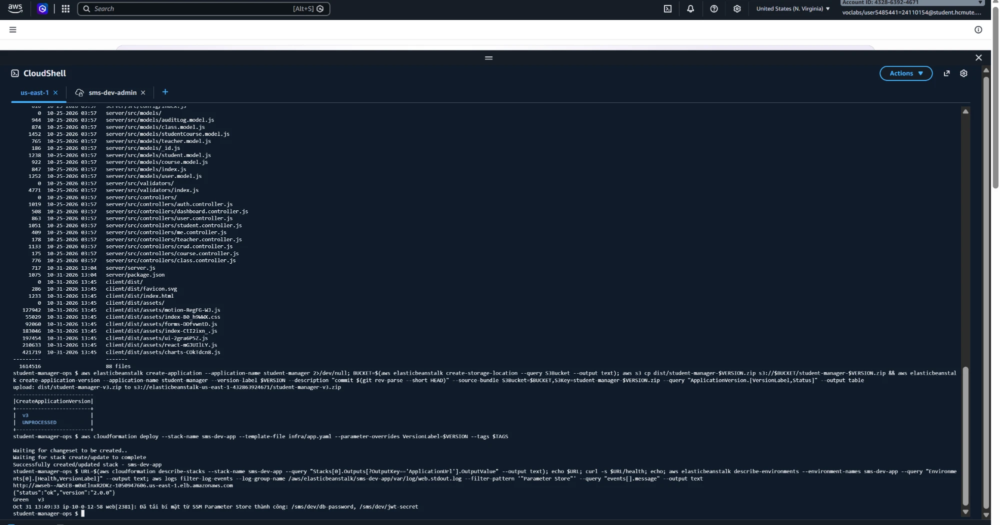

Sau đó chuyển `RequireSsl` lên `1`: tham số động nên áp dụng ngay, không khởi động lại RDS.

Kiểm chứng: kết nối không mã hóa bị từ chối với lỗi `ERROR 3159: Connections using insecure transport are prohibited`; đăng nhập qua API trước và sau khi bật đều thành công, chứng tỏ ứng dụng thực sự dùng SSL.

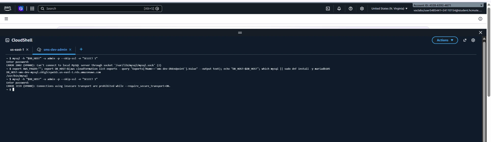
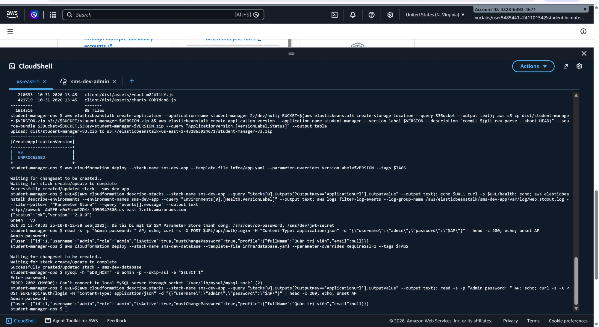

### 2.8. Giám sát (A5)

| Alarm | Metric | Ngưỡng |
| --- | --- | --- |
| `sms-dev-app-cpu-high` | `AWS/EC2 CPUUtilization` (theo ASG) | > 40% trong 5 phút; gửi cả khi hồi phục |
| `sms-dev-app-5xx` | `HTTPCode_Target_5XX_Count` | ≥ 5 lần/phút |
| `sms-dev-alb-5xx` | `HTTPCode_ELB_5XX_Count` | ≥ 5 lần/phút |
| `sms-dev-db-cpu-high` | `AWS/RDS CPUUtilization` | > 80% trong 5 phút |
| `sms-dev-db-storage-low` | `FreeStorageSpace` | < 2 GiB |

Dashboard `sms-dev`: CPU EC2, số instance, request và lỗi 5xx, thời gian phản hồi, CPU và kết nối RDS, dung lượng RDS. Email đã xác nhận đăng ký topic `sms-dev-alerts`.

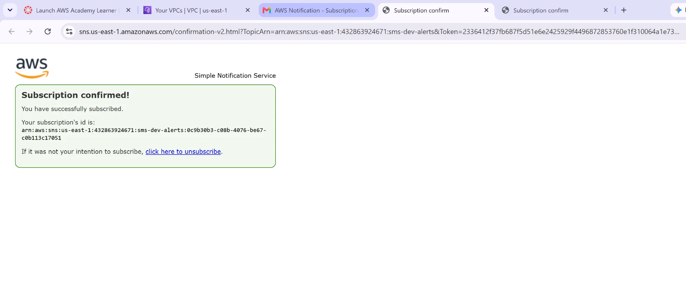
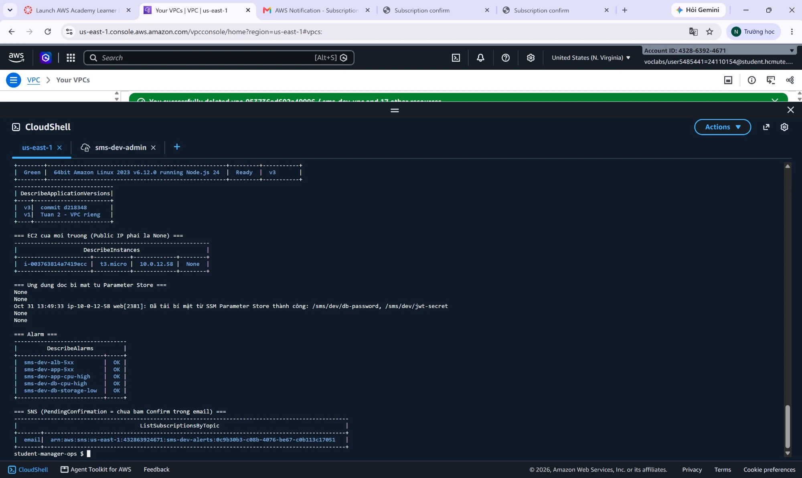

### 2.9. Rolling deploy và rollback (T6a, T6b)

Đổi phiên bản bằng tham số `VersionLabel` của stack: `v3 → v4` (Rolling, batch 1), sau đó trả về `v3`.

- **Account `2751-7291-1137` (Trần Lê Thái):** `v3 → v4 → v3`, cả hai lần `Green`. Hai phiên bản build từ cùng mã nguồn nên `/health` không đổi.
- **Account `4328-6392-4671` (Nông Hoàng Anh):** `v4` đổi `version` trong `/health` thành `2.1.0` để thấy rõ phiên bản đang chạy. Deploy `v4`: `/health` trả `2.1.0`, `Green v4`. Rollback: `/health` trả `2.0.0`, `Green v3`.

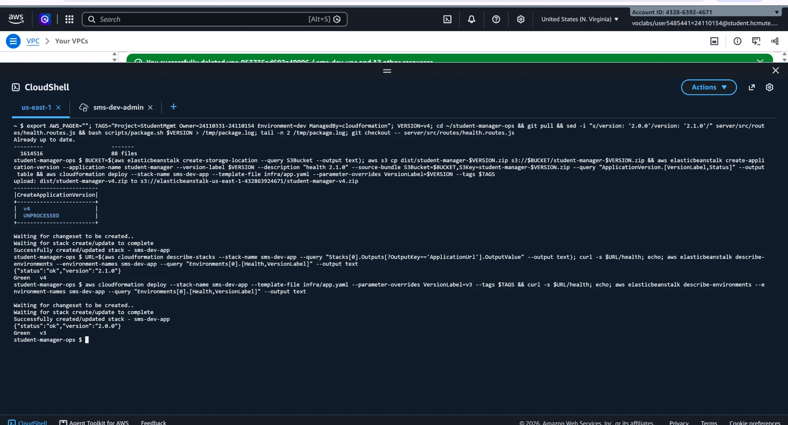

### 2.10. Bắn tải và Auto Scaling (T6b)

Bắn tải bằng `scripts/load-test.sh` (`autocannon`, 30 kết nối, 15 phút) vào `POST /api/auth/login` với mật khẩu sai: bcrypt tốn CPU và không ghi dữ liệu. Thực hiện trên account `4328-6392-4671`.

**Lần 1, ngưỡng 70%: không scale.**

| Chỉ số | Kết quả |
| --- | --- |
| Request | ~680/phút |
| Thời gian phản hồi | 2,7 giây |
| CPU EC2 | Đỉnh 50,9% |
| Lỗi 5xx | Không có |
| CPU RDS | Gần như không đổi: tải nằm ở bcrypt, không ở DB |

Trong bài thử này, CPU quan sát đạt đỉnh khoảng 51%, phù hợp với việc phần xử lý `bcryptjs` tập trung trên một luồng của tiến trình Node.js chạy trên máy 2 vCPU. Thời gian phản hồi 2,7 giây cho thấy ứng dụng đã chậm rõ rệt dù CPU chưa tới ngưỡng 70%. Nhóm điều chỉnh ngưỡng xuống 40% theo kết quả đo, ở cả trigger scale trong `app.yaml` và alarm trong `monitoring.yaml`.

**Lần 2, ngưỡng 40%: scale đúng thiết kế.**

| Chỉ số | Trước khi scale | Sau khi scale |
| --- | --- | --- |
| Số instance | 1 | 3 (đạt max, sau đó giảm về 2 khi hết tải) |
| Request | ~680/phút | ~2.030/phút (gấp 3) |
| Thời gian phản hồi | 2,7 giây | ~0,9 giây |
| Lỗi 5xx | 0 | 0 |

Hai cơ chế dưới đây độc lập, chỉ dùng chung ngưỡng 40%:

| Cơ chế | Cấu hình | Tác dụng | Bằng chứng |
| --- | --- | --- | --- |
| Tăng, giảm instance | Trigger `aws:autoscaling:trigger` trong `app.yaml` (Beanstalk tự tạo alarm scale riêng) | Thêm hoặc bớt instance | Biểu đồ số instance |
| Cảnh báo | Alarm `sms-dev-app-cpu-high` trong `monitoring.yaml`, action là SNS | Chỉ gửi email, không tác động tới Auto Scaling | Hai email `ALARM`, `OK` |

Alarm chuyển `OK → ALARM` với giá trị 50,96%, sau đó trở lại `OK` khi CPU trung bình còn 38,2%. Email chứng minh alarm và SNS hoạt động; việc tăng instance được chứng minh bằng biểu đồ số instance, không phải bằng email.

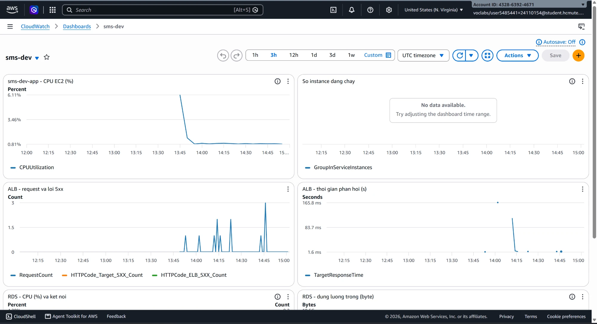
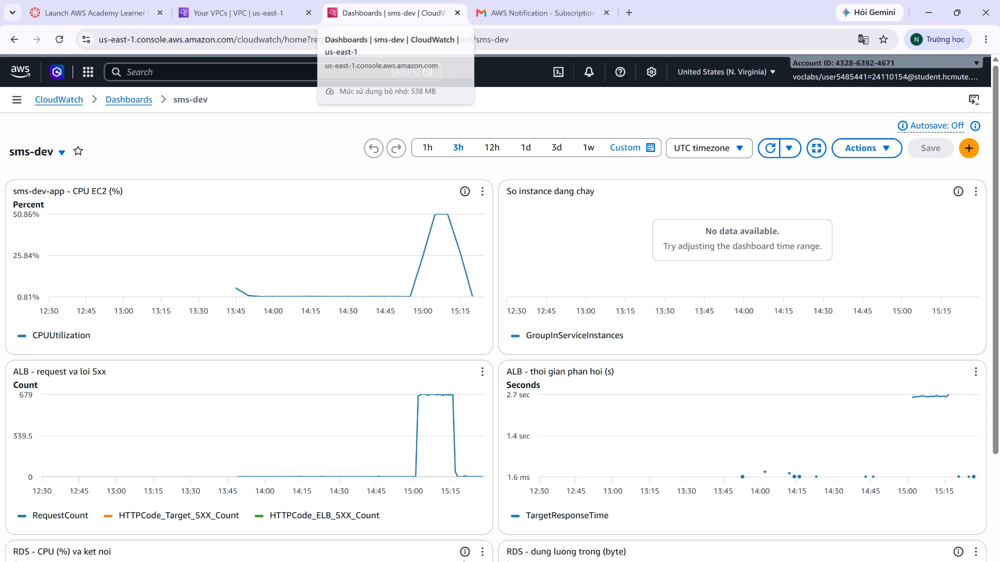
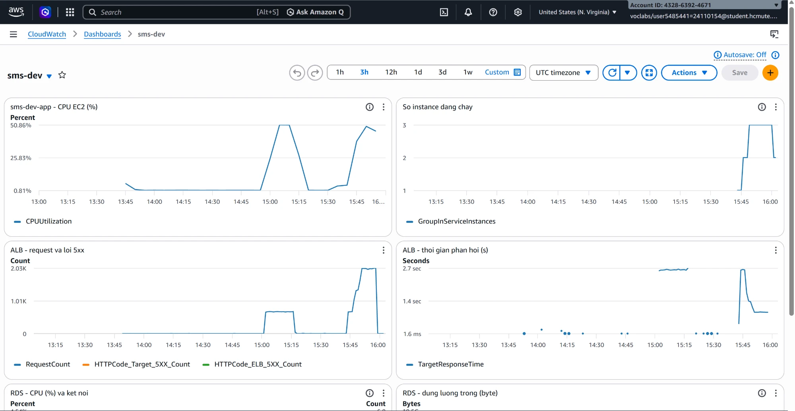
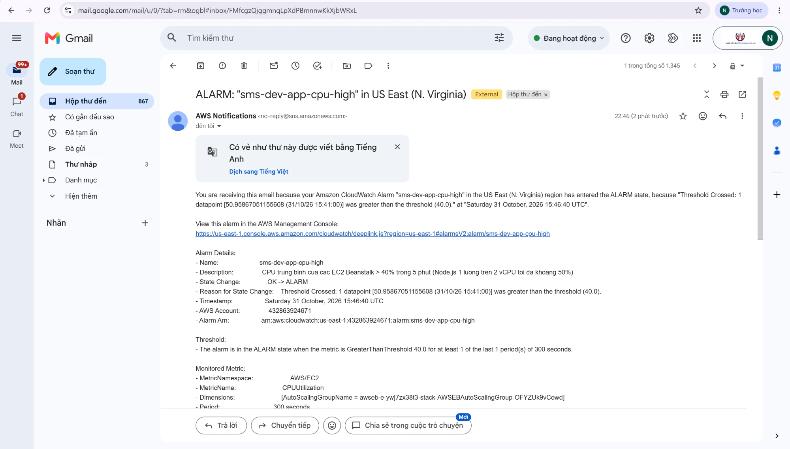
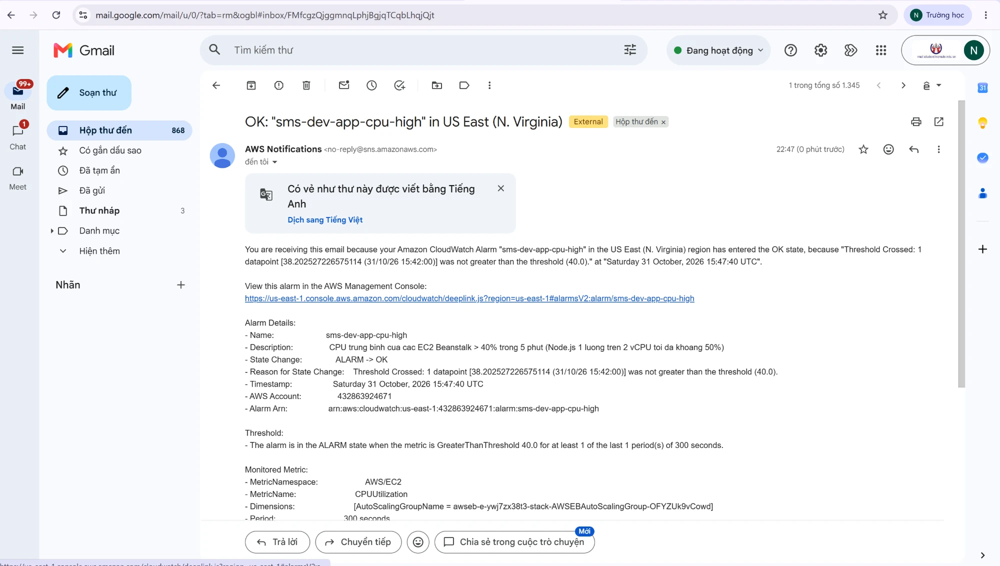

## 3. Kiểm thử từng thành phần

| Thành phần | Cách kiểm tra | Kết quả |
| --- | --- | --- |
| Mã nguồn | `npm test` | 126/126 đạt |
| Quyền Learner Lab | 6 bài A1 | 4/6 đạt, 2 bài có phương án thay thế |
| Stack mạng | `deploy`, `list-exports` | CREATE_COMPLETE, 8 export |
| Stack database | `deploy`, `describe-db-instances` | CREATE_COMPLETE, cấu hình đúng |
| NAT | `git clone` từ subnet app | Đạt |
| SG `AdminSg` → `DbSg` | Kết nối MySQL từ `sms-dev-admin` | Đạt, TLS 1.3 |
| Stack ứng dụng | Health, `/health`, đăng nhập | `Green`, đạt |
| Bí mật | Log ứng dụng | Đọc được cả 2 tham số |
| Rolling, rollback | `VersionLabel` v3 → v4 → v3 | `Green` cả 2 lần; `/health` đổi `2.0.0 → 2.1.0 → 2.0.0` |
| Stack giám sát | `deploy` | Thành công |
| `RequireSsl=1` | `mysql --skip-ssl`, đăng nhập sau khi bật | Bị từ chối (`ERROR 3159`); ứng dụng vẫn đăng nhập được |
| Alarm, Auto Scaling | `scripts/load-test.sh` | Lần 1 không scale (CPU đỉnh ~51%); hạ ngưỡng 40%, lần 2 lên 3 instance, có email `ALARM` và `OK` |

## 4. Kiến trúc

Kiến trúc mạng giữ như tuần 2 ([sơ đồ](../tuan-2/architecture-tuan-2.png)), khác ở chỗ:

- Hạ tầng dựng bằng CloudFormation (4 stack); phần ngoài stack (bí mật, dữ liệu, Application, Application Version) liệt kê ở mục 2.2.
- Route table private gộp thành 1 bảng app và 1 bảng DB.
- ALB dùng `sms-dev-alb-sg` của nhóm thay vì SG do Beanstalk tạo.
- Thêm Parameter Store, parameter group riêng cho RDS, SNS, alarm và dashboard.

## 5. Bảo mật: trước và sau

| Hạng mục | Cuối tuần 2 | Tuần 3 |
| --- | --- | --- |
| Mật khẩu DB, `JWT_SECRET` | Plain text trong cấu hình Beanstalk | `SecureString` trong Parameter Store; cấu hình chỉ chứa tên tham số |
| Mật khẩu master RDS | Đã lộ trong ảnh chụp | Đổi mật khẩu mới |
| SSL ứng dụng → RDS | Không | Có (`DB_SSL=true`) |
| RDS bắt buộc SSL | Không | `require_secure_transport = 1` |
| SG cho ALB | SG do Beanstalk tạo | `sms-dev-alb-sg` |
| SSH 22 | Chưa xác nhận đóng | `SSHSourceRestriction` chỉ cho `127.0.0.1` |
| Route DB | Gỡ NAT bằng tay | Không có route ra Internet trong template |
| `npm audit` | Có lỗ hổng High | Đã xử lý |

Tồn tại: API đăng nhập chưa giới hạn tần suất (rate limit); ứng dụng chạy HTTP (`COOKIE_SECURE=false`).

## 6. Tag

Truyền tag chung qua stack cho các tài nguyên hỗ trợ: `Project=StudentMgmt`, `Owner=24110331-24110154`, `Environment=dev`, `ManagedBy=cloudformation`. Tag `Name`, `Tier` khai báo trong template. Phần ngoài stack ở mục 2.2 không nhận tag này, ví dụ bucket S3 của Beanstalk và Application; hai tham số Parameter Store không gắn tag.

> ⏳ Kết quả kiểm tra tag thực tế: chạy lệnh trong `infra/README.md`, điền bảng và chụp `tag-01-kiem-tra.png`.

## 7. Phân công và thời gian thực hiện

| Mã | Công việc | Trần Lê Thái | Nông Hoàng Anh |
| --- | --- | --- | --- |
| A1 | Kiểm tra quyền Learner Lab | — | 0,5 giờ |
| A2 | `network.yaml`, dựng stack mạng | — | 2,5 giờ |
| A3 | Parameter Store, `database.yaml`, dựng stack database | — | 2 giờ |
| A4 | Nạp dữ liệu, xóa hạ tầng tuần 2 | — | 1 giờ |
| A5 | `monitoring.yaml` | — | 1,5 giờ |
| A6 | Báo cáo, dọn tài nguyên | — | 1,5 giờ |
| T1 | SSL, đọc Parameter Store | 1,5 giờ | — |
| T2 | `npm audit` | 0,5 giờ | — |
| T3 | `.ebextensions` | 0,5 giờ | — |
| T4 | `app.yaml` | 2,5 giờ | — |
| T5 | Dựng và kiểm tra toàn hệ thống | 1 giờ | — |
| T6a | Rolling, rollback trên account `2751-7291-1137` | 1,5 giờ | — |
| T6b | Bắn tải 2 lần, hạ ngưỡng CPU, rolling và rollback trên account `4328-6392-4671` | — | 1,5 giờ |
| T7 | Rà soát báo cáo | 0,5 giờ | — |
| | **Tổng** | **8 giờ** | **10,5 giờ** |

## 8. Commit và khả năng đối chiếu công việc

| Nhóm công việc | Người thực hiện | Commit |
| --- | --- | --- |
| `network.yaml` | Nông Hoàng Anh | [`ec0ed38`](https://github.com/devonxjz/student-manager-ops/commit/ec0ed38), [`4e09b87`](https://github.com/devonxjz/student-manager-ops/commit/4e09b87) |
| `database.yaml`, `monitoring.yaml`, A1, kế hoạch | Nông Hoàng Anh | [`0e304b7`](https://github.com/devonxjz/student-manager-ops/commit/0e304b7) |
| SSL, Parameter Store, `npm audit`, `.ebextensions`, `app.yaml` | Trần Lê Thái | [`1e7508c`](https://github.com/devonxjz/student-manager-ops/commit/1e7508c) |
| Sửa `app.yaml`, `infra/README.md` 10 bước | Nông Hoàng Anh | [`dce564e`](https://github.com/devonxjz/student-manager-ops/commit/dce564e) |
| Minh chứng, sửa nền tảng `app.yaml` | Trần Lê Thái | [`f6c448c`](https://github.com/devonxjz/student-manager-ops/commit/f6c448c), [`d218348`](https://github.com/devonxjz/student-manager-ops/commit/d218348) |

Bốn stack của tuần 3 có mã nguồn trong [`infra/`](../../infra/); phần ngoài stack ghi ở mục 2.2 và trong `infra/README.md`.

## 9. Khai báo sử dụng AI

**Nhóm có sử dụng AI trong tuần 3** (Claude). Mọi stack do sinh viên dựng và chạy thật trên Learner Lab.

| Hạng mục                                        | Công cụ | Phần AI hỗ trợ                                                | Phần sinh viên thực hiện                                              |
|-------------------------------------------------| --- |---------------------------------------------------------------|-----------------------------------------------------------------------|
| Kế hoạch tuần 3                                 | Claude | Đề xuất chia stack, hợp đồng, thứ tự phụ thuộc                | Duyệt, điều chỉnh                                                     |
| A1                                              | Claude | Kế hoạch kiểm tra                                               | Chạy lệnh kiểm tra, đọc kết quả, chọn phương án thay thế              |
| `network.yaml`, `database.yaml`, `monitoring.yaml`| Claude | Hướng dẫn từng khối, giải thích khái niệm, chỉ ra lỗi thụt lề | Viết file, dựng stack, kiểm tra export                                |
| `infra/README.md`                               | Claude | **Viết template và tài liệu** theo yêu cầu                    | Dựng stack, xử lý lỗi, kiểm tra cấu hình, giải thích được khi vấn đáp |
| `app.yaml`                                      | Claude | Sửa application, `VersionLabel`, SG của ALB, chu kỳ scale     | Trần Lê Thái viết bản đầu, dựng và kiểm tra                           |
| `scripts/verify-aws.sh`, `scripts/load-test.sh` | Claude | Viết script                                                   | Chạy, đọc kết quả                                                     |
| Báo cáo                                         | Claude | Viết cấu trúc chung cho báo cáo                               | Viết báo cáo, chuẩn bị nội dung, hình ảnh. Kiểm tra số liệu, bổ sung  |


## 12. Công việc chưa hoàn thành

| Hạng mục | Trạng thái |
| --- | --- |
| Rate limit cho API đăng nhập | Chưa làm |
| HTTPS | Chưa làm; `COOKIE_SECURE=false` |


## 14. Liên kết tổng hợp

- **Kế hoạch tuần 3:** [Kế hoạch tuần 3.md](K%E1%BA%BF%20ho%E1%BA%A1ch%20tu%E1%BA%A7n%203.md)
- **Kiểm tra quyền (A1):** [A1-kiem-tra-quyen.md](A1-kiem-tra-quyen.md)
- **Nhật ký công việc:** [worklog-tuan-3.md](worklog-tuan-3.md)
- **Template và hướng dẫn dựng:** [`infra/README.md`](../../infra/README.md)
- **Minh chứng:** [evidence/](evidence/)
