# BÁO CÁO TUẦN 4 – ĐỒ ÁN CLOUD COMPUTING

## Kiểm thử tổng thể, tối ưu chi phí, dọn dẹp tài nguyên và demo

**TRƯỜNG ĐẠI HỌC CÔNG NGHỆ KỸ THUẬT TP.HCM**  
**KHOA CÔNG NGHỆ THÔNG TIN**

| Thông tin | Nội dung |
| --- | --- |
| Học kỳ | Học kỳ I – Năm học 2026–2027 |
| Mã lớp | CLCO332779_05UTEXMC |
| Giảng viên hướng dẫn | TS. Huỳnh Xuân Phụng |
| Sinh viên 1 | Trần Lê Thái – 24110331 |
| Sinh viên 2 | Nông Hoàng Anh – 24110154 |
| Thời gian | Tuần 4 |
| Môi trường | AWS Academy Learner Lab, region `us-east-1`; hệ thống trình bày trong báo cáo chạy ở account `4328-6392-4671` (Nông Hoàng Anh) |
| Kho mã nguồn | [student-manager-ops](https://github.com/devonxjz/student-manager-ops) |
| Kế hoạch tuần 4 | [Kế hoạch tuần 4.md](K%E1%BA%BF%20ho%E1%BA%A1ch%20tu%E1%BA%A7n%204.md) |
| Nhật ký công việc | [worklog-tuan-4.md](worklog-tuan-4.md) |

> Mục tiêu tuần 4 theo GVHD: kiểm thử tổng thể, tối ưu chi phí, dọn dẹp tài nguyên, viết báo cáo và demo. Ảnh minh chứng có Account ID, region và thời gian nằm trong thư mục `evidence/`.

## 1. Tổng kết công việc tuần 4

Tuần 4 hoàn thiện hệ thống ở tuần 3 theo nhận xét của GVHD: thêm **rate limit** cho API đăng nhập và **HTTPS** (API Gateway HTTP API đặt trước ALB, vì Learner Lab chặn CloudFront). Nhóm cũng thử khả năng chịu lỗi (mất EC2, tắt/bật NAT, dựng lại stack ứng dụng), kiểm tra tag thực tế, vẽ sơ đồ kiến trúc cuối, so sánh phương án chi phí, rồi kiểm thử tổng thể, demo và dọn tài nguyên. Hệ thống hiện gồm 5 stack CloudFormation (thêm `sms-dev-https`). Phân công được điều chỉnh giữa tuần (xem [Kế hoạch tuần 4](K%E1%BA%BF%20ho%E1%BA%A1ch%20tu%E1%BA%A7n%204.md), mục 1a): Trần Lê Thái nhận thêm A1, A4 và demo trên account `2751-7291-1137`.

### 1.1. Danh sách công việc và dẫn chứng

| STT | Mã | Công việc | Người     | Trạng thái | Dẫn chứng |
| --- | --- | --- |-----------| - | --- |
| 1 | T1 | Kiểm thử chức năng trên URL thật | Thái      |  | Mục 2.1 |
| 2 | T2 | Sửa lỗi; rate limit API đăng nhập | Thái      | Đã code, có test| Mục 2.2 |
| 3 | A6 | HTTPS qua API Gateway | Hoàng Anh | ✔ | Mục 2.2 |
| 4 | A2 | Thử khả năng chịu lỗi, dựng lại từ template | Hoàng Anh | ✔ | Mục 2.3 |
| 5 | A3 | Sơ đồ kiến trúc cuối | Hoàng Anh | ✔ | Mục 4 |
| 6 | A1 | Tối ưu chi phí | Thái      | Đã so sánh phương án;  số liệu thực tế | Mục 3 |
| 7 | T3, T4 | Chuẩn bị và thực hiện demo | Thái      |  | Mục 5 |
| 8 | A5, T5 | Dọn tài nguyên | Cả hai    | Account `4328-6392-4671` xong; account `2751-7291-1137` giữ cho buổi báo cáo cuối | Mục 6 |
| 9 | A4, T5 | Báo cáo, rà soát | Hoàng Anh | ✔ | Báo cáo này |

### 1.2. Mốc

| Mốc | Tiêu chí | Trạng thái |
| --- | --- | -- |
| M1 | Có HTTPS, đăng nhập được với `COOKIE_SECURE=true` | ✔ |
| M2 | Có rate limit đăng nhập, có test | ✔ |
| M3 | Có bảng kiểm thử chức năng với kết quả thật |  |
| M4 | Demo xong | ✔ |
| M5 | Dọn tài nguyên | Xong account `4328-6392-4671`; account `2751-7291-1137` dọn sau buổi báo cáo cuối |

## 2. Kiểm thử tổng thể

Môi trường kiểm thử: stack `sms-dev-app` trên account `2751-7291-1137` (Trần Lê Thái), bản code có rate limit và dữ liệu demo, truy cập qua URL HTTPS của API Gateway.

### 2.1. Kiểm thử chức năng (T1)

| Mã | Vai trò | Thao tác | Kết quả mong đợi | Kết quả thực tế |
| --- | --- | --- | --- |-----------------|
| TC01 | Quản trị | Đăng nhập đúng mật khẩu | Vào dashboard quản trị | Đã kiểm chứng   |
| TC02 | Bất kỳ | Đăng nhập sai mật khẩu | Báo lỗi, không vào được | Đã kiểm chứng               |
| TC03 | Quản trị | Thêm, sửa, xóa lớp | Dữ liệu cập nhật | Đã kiểm chứng               |
| TC04 | Quản trị | Thêm giáo viên, môn học | Dữ liệu cập nhật | Đã kiểm chứng               |
| TC05 | Quản trị | Khóa, mở tài khoản, đặt lại mật khẩu | Tài khoản bị khóa không đăng nhập được | Đã kiểm chứng               |
| TC06 | Giáo viên | Thêm, sửa, xóa sinh viên lớp chủ nhiệm | Dữ liệu cập nhật | Đã kiểm chứng               |
| TC07 | Giáo viên | Nhập điểm | Tín chỉ của sinh viên cập nhật | Đã kiểm chứng               |
| TC08 | Giáo viên | Truy cập sinh viên lớp khác | Bị từ chối | Đã kiểm chứng
| TC09 | Sinh viên | Xem tín chỉ của mình | Hiển thị đúng | Đã kiểm chứng               |
| TC10 | Sinh viên | Truy cập trang quản trị | Bị từ chối | Đã kiểm chứng               |
| TC11 | Bất kỳ | Đổi mật khẩu, đăng nhập lại | Mật khẩu mới dùng được | Đã kiểm chứng               |
| TC12 | Khách | Gọi API cần đăng nhập khi chưa đăng nhập | Bị từ chối | Đã kiểm chứng               |

Kiểm thử tự động: `npm test` trong `server/` đạt **129/129 test, 9/9 bộ test** trên bản code mới nhất (commit `c70772e`, gồm rate limit và seed demo). Tuần 3 là 126/126; tuần 4 thêm 3 test trong `server/tests/rateLimit.test.js`. Test chạy trên máy cục bộ với SQLite trong bộ nhớ, không chạy trên AWS.

### 2.2. Lỗi phát hiện, rate limit và HTTPS (T2, A6)

| Lỗi | Nguyên nhân | Cách sửa | Commit |
| --- | --- | --- | --- |
| `trust proxy` đặt cố định `1`: sau ALB và nginx, rate limit sẽ lấy IP của proxy, gộp mọi người dùng thành một IP | Chuỗi proxy thật là client → (API Gateway) → ALB → nginx → Node | `trust proxy` đọc từ `TRUST_PROXY` (mặc định 2: ALB + nginx); `app.yaml` thêm tham số `TrustProxy`, đặt `3` khi đi qua API Gateway | [`42e6971`](https://github.com/devonxjz/student-manager-ops/commit/42e6971), [`acc8832`](https://github.com/devonxjz/student-manager-ops/commit/acc8832) |
| Ứng dụng crash khi khởi động: `Cannot find module 'express-rate-limit'` | Beanstalk cài thư viện từ `package.json` ở thư mục gốc, không phải `server/package.json` | Thêm `express-rate-limit` vào `package.json` gốc | [`2c44215`](https://github.com/devonxjz/student-manager-ops/commit/2c44215) |

Hai việc GVHD yêu cầu hoàn thành trong tuần 4 (nhận xét tuần 3):

| Việc | Cách làm | Kiểm chứng | Kết quả |
| --- | --- | --- | --- |
| Rate limit `POST /api/auth/login` | `express-rate-limit` (`server/src/middlewares/rateLimit.js`): tối đa 10 lần đăng nhập **sai** trong 15 phút theo IP (`LOGIN_RATE_MAX`, `LOGIN_RATE_WINDOW_MIN`); đăng nhập đúng không bị đếm; vượt ngưỡng trả `429` kèm `Retry-After`, chặn trước bcrypt và DB | Test tự động `rateLimit.test.js`: sai quá ngưỡng nhận `429` kể cả khi sau đó nhập đúng; IP khác không bị ảnh hưởng; đăng nhập đúng không bị đếm. ⏳ Chạy lại trên URL thật qua HTTPS | Test tự động: 3/3 trường hợp đạt (nằm trong 129/129); ⏳ kiểm chứng trên URL thật |
| HTTPS | API Gateway HTTP API trước ALB (`infra/https.yaml`) | Truy cập `https://…execute-api.us-east-1.amazonaws.com`, đăng nhập được với `COOKIE_SECURE=true` | Đạt: `https://k1jlg48fvc.execute-api.us-east-1.amazonaws.com`, vào được trang quản trị |

Lý do chọn API Gateway: CloudFront bị Learner Lab chặn (`no identity-based policy allows the cloudfront:CreateDistribution`). Thử tạm API Gateway cho kết quả: `/health` 200, trang chủ 200, đăng nhập 200 có `set-cookie`. Chứng chỉ tự ký trên ALB cũng khả thi (ACM nhập được) nhưng trình duyệt sẽ cảnh báo, nên không chọn.

Giới hạn: đoạn API Gateway → ALB vẫn là HTTP; ALB vẫn nhận trực tiếp từ Internet (khi đó `TRUST_PROXY=3` không khớp chuỗi proxy). Rate limit đếm trong bộ nhớ từng instance, nên khi Auto Scaling có nhiều instance thì mỗi instance đếm riêng, ngưỡng thực tế cao hơn 10 lần/IP.

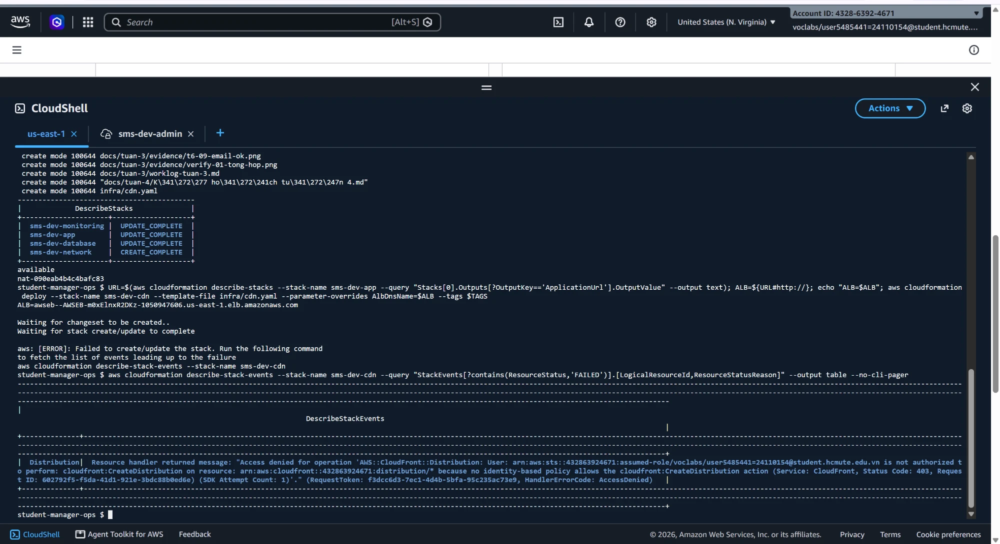
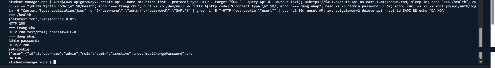
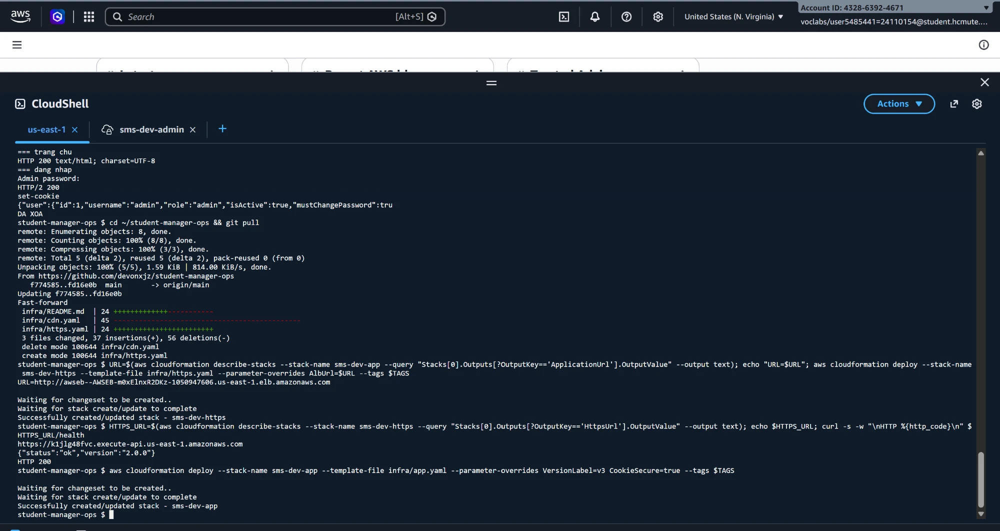
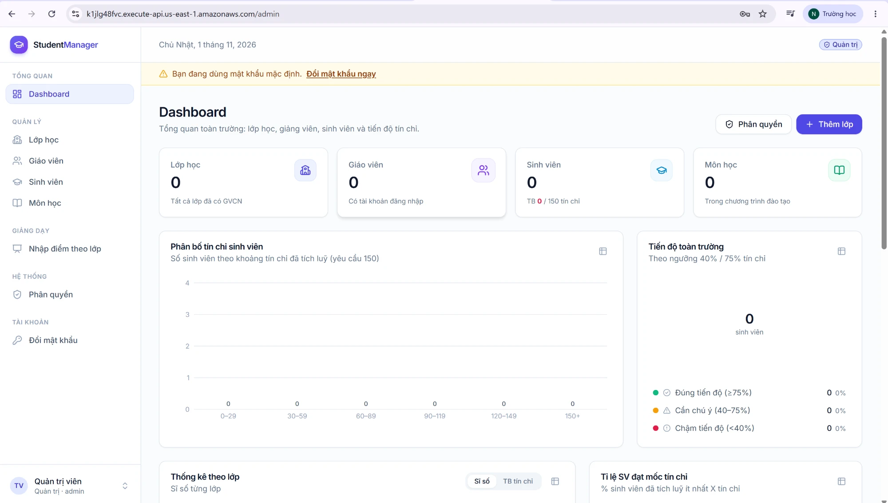

### 2.3. Khả năng chịu lỗi và dựng lại (A2)

| Kịch bản | Thao tác | Kết quả mong đợi | Kết quả thực tế |
| --- | --- | --- | --- |
| Mất EC2 | Terminate 1 instance | ASG tự tạo instance mới, ứng dụng trả lời lại | Đạt: `i-0778…` được thay bằng `i-0329…`, `/health` trả 200 sau khoảng 61 giây (đo mỗi 20 giây); EC2 mới không có IP public. Hệ thống chỉ có 1 instance nên ứng dụng gián đoạn trong khoảng này |
| Tắt, bật NAT | `EnableNat=false`, rồi `true` | NAT, Elastic IP, route tự xóa và tạo lại | Đạt: tắt 71 giây (không còn NAT), bật 162 giây (có `nat-0deda…`) |
| Dựng lại stack ứng dụng | Xóa `sms-dev-https`, `sms-dev-monitoring`, `sms-dev-app`, deploy lại `app.yaml` với `v3` | Stack dựng lại thành công | Stack thành công: xóa 335 giây, dựng 337 giây. Chưa dựng lại mạng và database, chưa kiểm tra Health sau khi dựng |

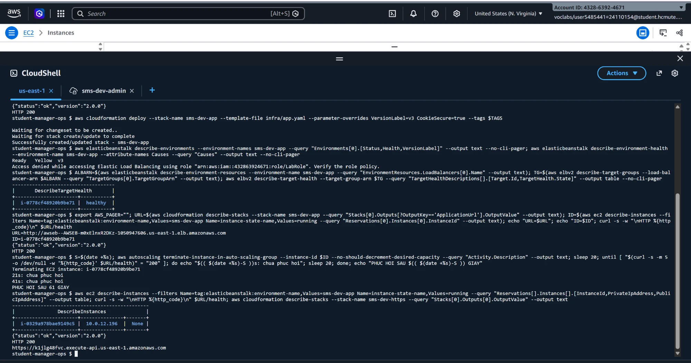
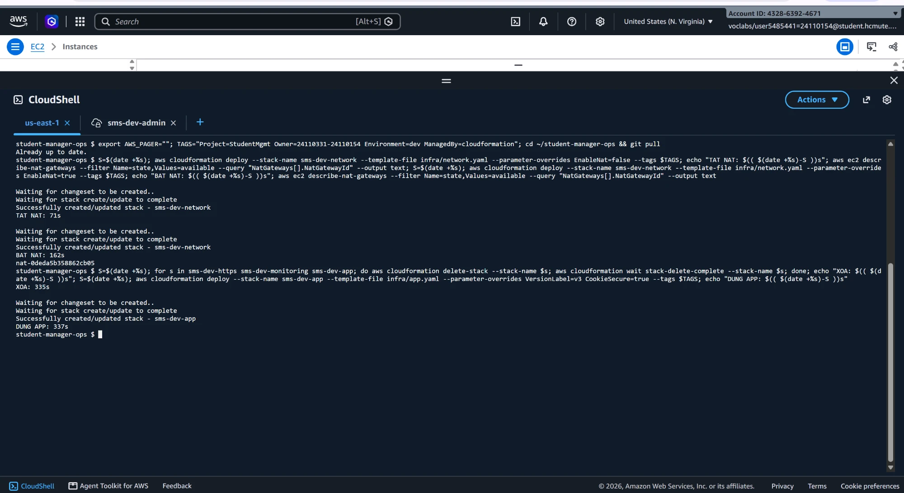

### 2.4. Kiểm tra tag thực tế

Tag Editor bị SCP của AWS Academy chặn, nên nhóm dùng Tagging API, lọc `Project=StudentMgmt` trên account `4328-6392-4671`. Tag có trên: VPC, 6 subnet, 3 route table, Internet Gateway, NAT, Elastic IP, VPC endpoint, security group, EC2, ALB, listener, target group, RDS, parameter group, DB subnet group, snapshot RDS, môi trường Beanstalk, alarm, dashboard, SNS topic, API Gateway. Danh sách không có bucket S3 của Beanstalk, Application và tham số Parameter Store, đúng với phần ngoài stack.

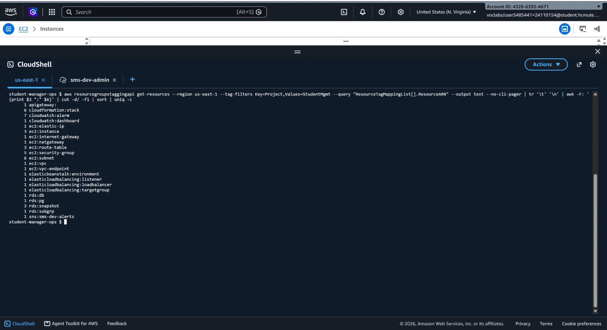

### 2.5. Kết quả đã có từ tuần 3

Không kiểm thử lại trong phần này, chi tiết ở [báo cáo tuần 3](../tuan-3/B%C3%A1o%20c%C3%A1o%20tu%E1%BA%A7n%203.md):

| Nội dung | Kết quả |
| --- | --- |
| RDS bắt buộc SSL | `--skip-ssl` bị từ chối, ứng dụng vẫn đăng nhập được |
| Rolling, rollback | `/health` đổi `2.0.0 → 2.1.0 → 2.0.0`, `Green` cả 2 lần |
| Auto Scaling | Ngưỡng 40%: từ 1 lên 3 instance; phản hồi từ 2,7 giây còn ~0,9 giây |
| Alarm, SNS | Có email `ALARM` và `OK` |

## 3. Tối ưu chi phí (A1)

### 3.1. Chi phí theo tài nguyên

Đơn giá tham khảo theo bảng giá công khai của AWS tại `us-east-1` (On-Demand, Linux); Learner Lab có thể tính khác đôi chút.

| Tài nguyên | Đơn giá/giờ | Ghi chú |
| --- | --- | --- |
| NAT Gateway | ~$0.045 + phí dữ liệu | Tính cả khi không có tải |
| 3 IPv4 public (NAT, 2 của ALB) | ~$0.015 | |
| Application Load Balancer | ~$0.0225 + LCU | |
| EC2 t3.micro × 1 | ~$0.0104 | Nhiều hơn khi scale |
| RDS db.t3.micro + 20 GiB gp3 | ~$0.020 | |
| **Tổng** | **~$0.11/giờ (~$2.6/ngày)** | Khi chạy 1 instance |

### 3.2. Các phương án đã so sánh

| Quyết định | Phương án chọn | Phương án khác | Chênh lệch ước tính | Đánh đổi |
| --- | --- | --- | --- | --- |
| Số NAT | 1 NAT | 2 NAT (mỗi AZ) | Tiết kiệm ~$0.045/giờ | AZ chứa NAT hỏng thì subnet app ở AZ kia mất đường ra Internet |
| RDS | Single-AZ | Multi-AZ | Tiết kiệm khoảng một nửa phí instance | Không có standby tự chuyển đổi |
| Loại EC2 | t3.micro | t3.small | Tiết kiệm ~$0.01/giờ mỗi instance | Ít tài nguyên hơn, dựa vào scale ngang |
| Khi nghỉ | `EnableNat=false`, xóa stack app, stop RDS | Để chạy liên tục | Tiết kiệm phần lớn ~$2.6/ngày | Mất khoảng 25 phút dựng lại |
| S3 | Gateway endpoint | Đi qua NAT | Không tốn phí xử lý dữ liệu NAT | Không |
| Scale | Min 1, max 3 | Chạy cố định 3 | Giảm EC2 khi tải thấp | Mất vài phút mới thêm instance |

### 3.3. Chi phí thực tế

| Account | Đã dùng            | Ghi chú |
| --- |--------------------| --- |
| `4328-6392-4671` | `Used $5.5 of $50` | 11% ngân sách, tính cho cả tuần 2–4; đã dọn |
| `2751-7291-1137` | `Used $23 of $50`   | |

Kết luận:

- **Nằm trong ngân sách.** Account `4328-6392-4671` dùng $5.5 trên $50 (11%) sau tuần 2–4, còn $44.5.
- **Khớp với ước tính.** Theo đơn giá mục 3.1 (khoảng $0.11/giờ khi chạy đủ hệ thống), $5.5 tương ứng khoảng 50 giờ chạy đầy đủ, phù hợp với thời gian thực tế các buổi làm việc và bắn tải.
- **Dọn dẹp là yếu tố chính giữ chi phí thấp.** Nếu để hệ thống chạy liên tục 3 tuần, chi phí ước tính khoảng $2.6 × 21 ≈ $55, vượt ngân sách. Nhóm giữ được ở mức $5.5 nhờ tắt NAT, xóa stack khi nghỉ và dọn tài nguyên sau mỗi đợt.
- **Khoản lớn nhất theo ước tính là NAT Gateway** (khoảng 40% chi phí mỗi giờ), sau đó là ALB và IPv4 public. Đây là các khoản tính theo giờ dù không có tải; EC2 và RDS loại micro chiếm phần nhỏ hơn. Nhóm chưa tách được chi phí thực tế theo từng dịch vụ, nên tỷ lệ này dựa trên đơn giá chứ không phải hóa đơn.

## 4. Kiến trúc cuối cùng (A3)

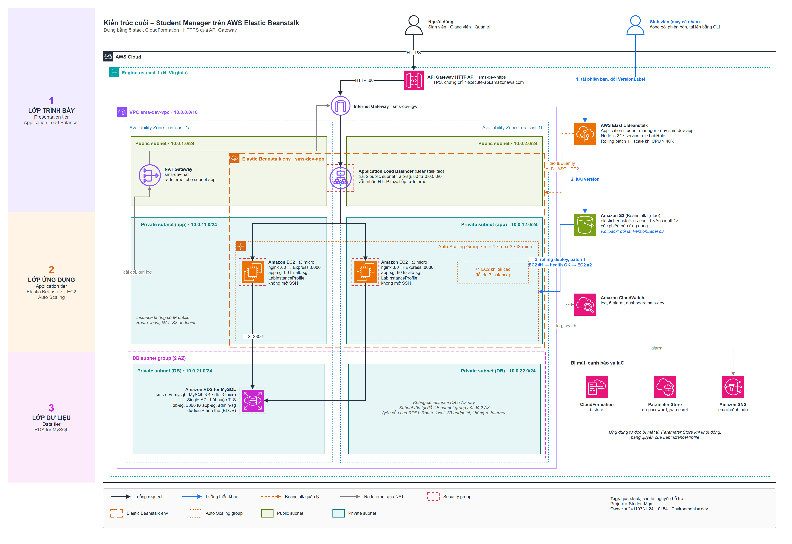

So với sơ đồ tuần 2: thêm API Gateway cho HTTPS, Parameter Store, SNS, alarm, dashboard; route table DB không ra Internet; RDS bắt buộc TLS; hạ tầng dựng bằng 5 stack CloudFormation. Tệp gốc: [`architecture-final.drawio`](architecture-final.drawio). Phần ngoài stack ghi ở mục 2.2 báo cáo tuần 3.

## 5. Demo (T3, T4)

Hình thức: video quay màn hình, có thuyết minh, truy cập ứng dụng qua URL HTTPS của API Gateway. Tệp: `docs/video/video_demo.mp4`. ⏳ Cập nhật độ dài và link sau khi quay lại bản cuối.

| Nội dung | Đã trình bày |
| --- |  |
| Ứng dụng chạy thật, 3 vai trò |  |
| Hạ tầng: stack, EC2 không IP public, RDS không public |  |
| Bảo mật: Parameter Store, SSL bắt buộc |  |
| Rolling deploy và rollback |  |
| Auto Scaling, alarm, dashboard |  |

## 6. Dọn dẹp tài nguyên (A5, T5)

Lý do dọn: Learner Lab cấp ngân sách giới hạn cho mỗi account; NAT Gateway, ALB, IPv4 public và RDS tính tiền theo giờ kể cả khi không có người dùng (khoảng $2.6/ngày, mục 3.1), nên tài nguyên không dùng nữa phải xóa để không tiêu hết ngân sách.

Account `4328-6392-4671` (Nông Hoàng Anh) đã dọn sau khi xong A2. Account `2751-7291-1137` (Trần Lê Thái) **được giữ lại** để trình bày ở buổi báo cáo cuối, và sẽ dọn theo cùng các bước ngay sau buổi đó. Trong thời gian chờ, nhóm giảm chi phí bằng cách tắt NAT (`EnableNat=false`) khi không dùng.

| Tài nguyên | Account `4328-6392-4671` | Account `2751-7291-1137` |
| --- | --- | --- |
| Stack https, monitoring, app, database, network | Đã xóa | Giữ cho buổi báo cáo cuối |
| Snapshot RDS | Chưa xác nhận: lần kiểm tra cuối còn một dòng `v1` chưa rõ là tài nguyên gì; lab đã kết thúc nên chưa kiểm tra lại | Giữ cho buổi báo cáo cuối |
| Tham số Parameter Store | Đã xóa | Giữ (ứng dụng cần khi khởi động) |
| Application Beanstalk, các phiên bản | Đã xóa | Giữ |
| Bucket S3 của Beanstalk | Đã xóa | Giữ |
| CloudWatch Logs (giữ lại khi terminate) | Đã xóa | Giữ |
| CloudShell VPC environment | Chưa xác nhận đã xóa | Giữ |

Phần ngoài stack không bị xóa theo stack nên phải kiểm tra riêng. Thứ tự xóa và lệnh kiểm tra ở mục "Xóa" trong [`infra/README.md`](../../infra/README.md).

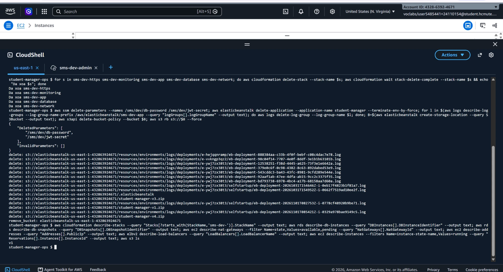

## 7. Phân công và thời gian thực hiện

| Mã | Công việc | Trần Lê Thái | Nông Hoàng Anh |
| --- | --- | --- | --- |
| A1 | Tối ưu chi phí | 1 giờ | — |
| A2 | Chịu lỗi, dựng lại | — | 2 giờ |
| A3 | Sơ đồ kiến trúc cuối | — | 1,5 giờ |
| A4 | Báo cáo | — | 2 giờ |
| A5 | Dọn tài nguyên | — | 1,5 giờ |
| A6 | HTTPS | — | 3 giờ |
| T1 | Kiểm thử chức năng | 1,5 giờ | — |
| T2 | Sửa lỗi, rate limit | 2,5 giờ | — |
| T3, T4 | Chuẩn bị và thực hiện demo | 2 giờ | — |
| T5 | Rà soát, dọn tài nguyên | 1 giờ | — |
| | **Tổng** | **8 giờ** | **10 giờ** |

Chi tiết theo [worklog](worklog-tuan-4.md). Số giờ ước lượng lại sau khi làm, theo khối lượng từng việc.

## 8. Commit và khả năng đối chiếu công việc

| Nhóm công việc | Người thực hiện | Commit |
| --- | --- | --- |
| HTTPS: thử CloudFront, chuyển sang API Gateway (`https.yaml`), tham số `CookieSecure` | Nông Hoàng Anh | [`f774585`](https://github.com/devonxjz/student-manager-ops/commit/f774585), [`fd16e0b`](https://github.com/devonxjz/student-manager-ops/commit/fd16e0b) |
| Sơ đồ cuối, kết quả A2, A5, phân công lại | Nông Hoàng Anh | [`945fcae`](https://github.com/devonxjz/student-manager-ops/commit/945fcae) |
| Sửa `app.yaml` | Nông Hoàng Anh | [`575e10c`](https://github.com/devonxjz/student-manager-ops/commit/575e10c) |
| Rate limit đăng nhập, sửa `trust proxy`, test | Trần Lê Thái | [`42e6971`](https://github.com/devonxjz/student-manager-ops/commit/42e6971) |
| Tham số `TrustProxy` trong `app.yaml`, README bước 11 | Trần Lê Thái | [`acc8832`](https://github.com/devonxjz/student-manager-ops/commit/acc8832) |
| Sửa lỗi thiếu thư viện khi deploy | Trần Lê Thái | [`2c44215`](https://github.com/devonxjz/student-manager-ops/commit/2c44215) |
| Seed dữ liệu demo (lớp, giáo viên, sinh viên) | Trần Lê Thái | [`2fb2582`](https://github.com/devonxjz/student-manager-ops/commit/2fb2582) |

## 9. Khai báo sử dụng AI

**Nhóm có sử dụng AI trong tuần 4** (Claude). Mọi thao tác trên AWS do sinh viên thực hiện và chạy thật trên Learner Lab.

| Hạng mục | Công cụ | Phần AI hỗ trợ | Phần sinh viên thực hiện |
| --- | --- | --- | --- |
| Kế hoạch, khung báo cáo | Claude | Đề xuất việc, dựng khung | Duyệt, điền kết quả thật |
| Rate limit, `trust proxy`, `seed-demo.js`, tham số `TrustProxy` | Claude | Hỗ trợ viết code và test (ghi trong commit) | Trần Lê Thái chạy, kiểm tra, giải thích được khi vấn đáp |
| `infra/https.yaml` (và bản CloudFront đã bỏ) | Claude | Viết template, soạn lệnh thử API Gateway và ACM | Nông Hoàng Anh chạy thử trên Learner Lab, phát hiện CloudFront bị chặn, dựng stack, kiểm tra đăng nhập qua HTTPS |
| Sơ đồ kiến trúc cuối | Claude | Vẽ sơ đồ bằng script theo đặc tả | Nông Hoàng Anh chốt nội dung (thành phần, luồng, ghi chú), đối chiếu với hệ thống thật |
| Thử chịu lỗi (A2), dọn tài nguyên (A5), kiểm tra tag | Claude | Soạn lệnh CLI, cách đo thời gian | Nông Hoàng Anh chạy trên account `4328-6392-4671`, ghi số liệu, chụp minh chứng |
| Nội dung báo cáo | Claude | Hỗ trợ viết, rà soát câu chữ | Hai thành viên cung cấp kết quả thật, duyệt nội dung |

## 10. Khó khăn gặp phải và cách xử lý

| Khó khăn | Nguyên nhân | Cách xử lý |
| --- | --- | --- |
| Không tạo được CloudFront | Learner Lab không cấp `cloudfront:CreateDistribution` | Dùng API Gateway HTTP API |
| Môi trường `Red`, ALB trả 502 dù stack vẫn `UPDATE_COMPLETE` | Hệ thống để chạy qua lúc hết phiên lab; instance bị thay (`16:41`) và instance mới không chạy ứng dụng. Nguyên nhân gốc là suy luận từ Events và log | Terminate instance để ASG tạo instance mới; đầu buổi kiểm tra `/health`, không chỉ xem trạng thái stack |
| Môi trường `Yellow`: *Access denied while accessing Elastic Load Balancing using role LabRole* | Chưa xác định; ALB vẫn báo target `healthy`, ứng dụng hoạt động | Không ảnh hưởng ứng dụng. Chưa kiểm chứng được sau khi dựng lại, vì môi trường đã dọn |

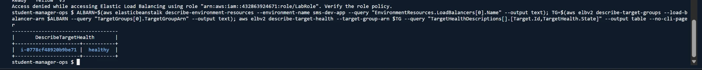
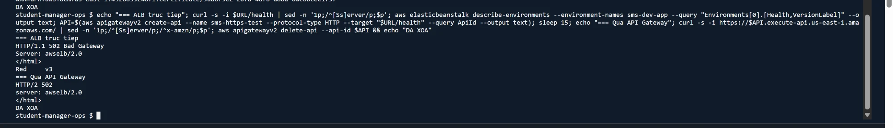
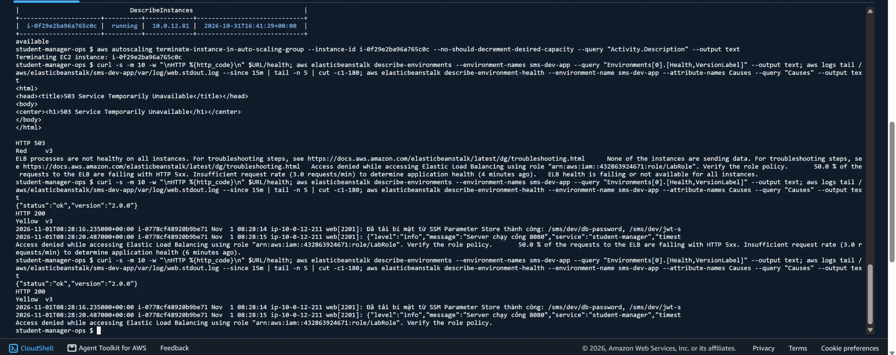

## 11. Công việc chưa hoàn thành và hướng phát triển

| Hạng mục | Trạng thái |
| --- | --- |
| Đoạn API Gateway → ALB vẫn là HTTP; ALB nhận trực tiếp từ Internet | Chưa xử lý (hướng phát triển: chỉ cho phép traffic từ API Gateway, hoặc dùng domain riêng với ACM + ALB HTTPS) |
| Rate limit đếm theo từng instance | Chưa dùng kho chung; hướng phát triển: Redis/ElastiCache hoặc giới hạn ở API Gateway |
| Dựng lại mạng và database từ đầu | Chưa thử, mới dựng lại stack ứng dụng |
| Lỗi `Yellow` *Access denied … LabRole* | Chưa xác định nguyên nhân (mục 10) |
| Xác nhận sạch hoàn toàn account `4328-6392-4671` | Còn dòng `v1` và CloudShell VPC environment chưa kiểm tra lại (mục 6) |
| Dọn tài nguyên account `2751-7291-1137` | Giữ cho buổi báo cáo cuối, dọn ngay sau đó |

## 12. Liên kết tổng hợp

- **Kế hoạch tuần 4:** [Kế hoạch tuần 4.md](K%E1%BA%BF%20ho%E1%BA%A1ch%20tu%E1%BA%A7n%204.md)
- **Nhật ký công việc:** [worklog-tuan-4.md](worklog-tuan-4.md)
- **Báo cáo tuần 3:** [Báo cáo tuần 3.md](../tuan-3/B%C3%A1o%20c%C3%A1o%20tu%E1%BA%A7n%203.md)
- **Minh chứng:** [evidence/](evidence/)
- **Template và hướng dẫn dựng:** [`infra/README.md`](../../infra/README.md)
